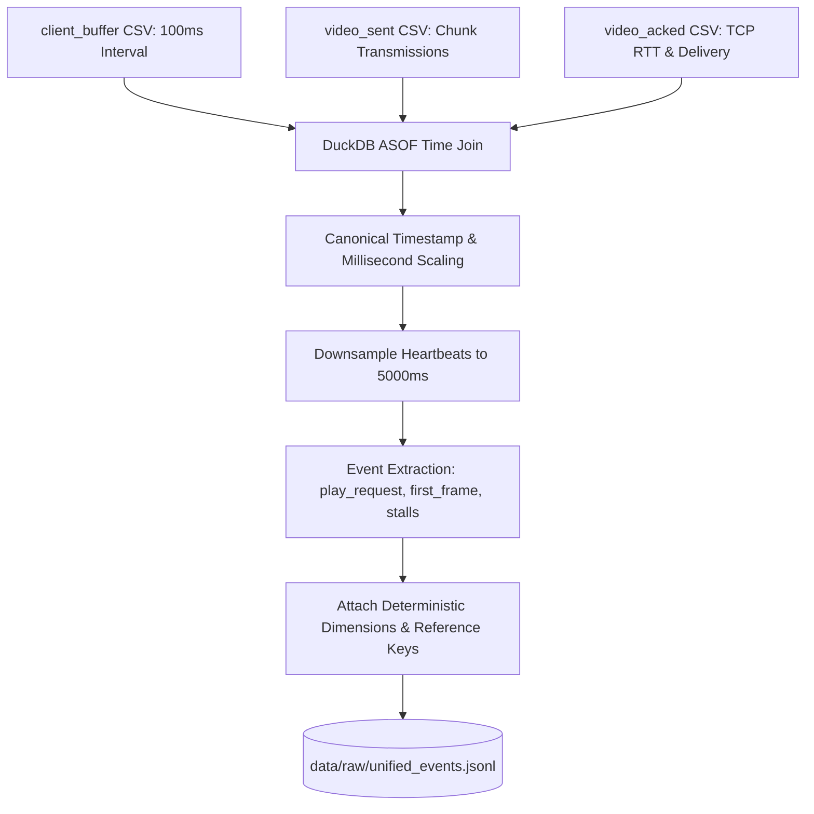
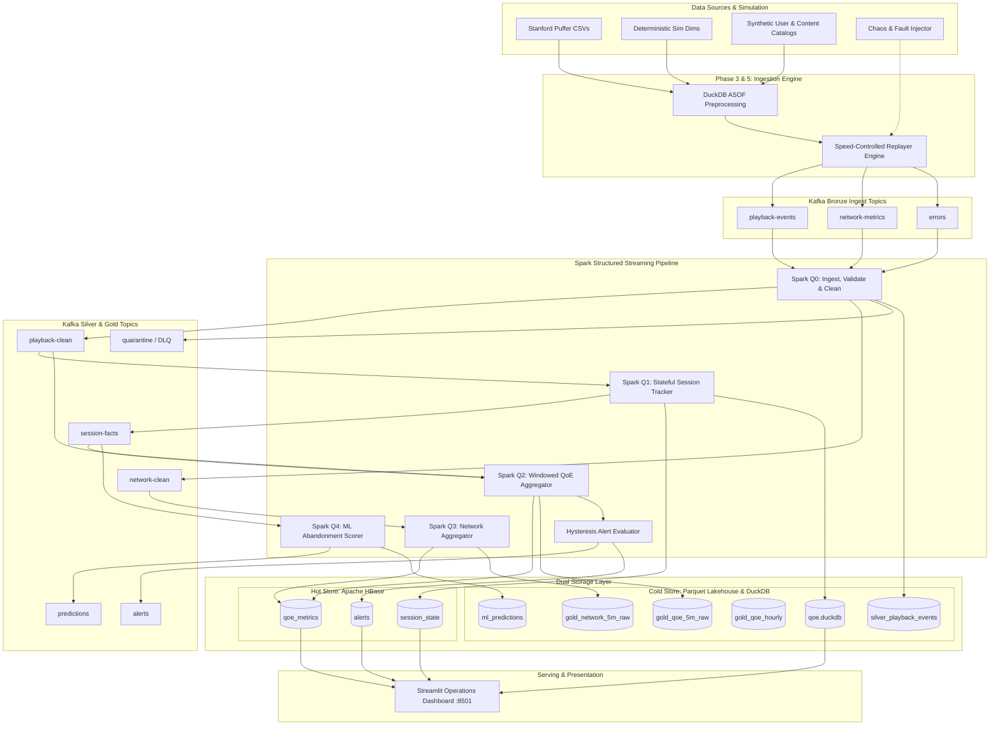
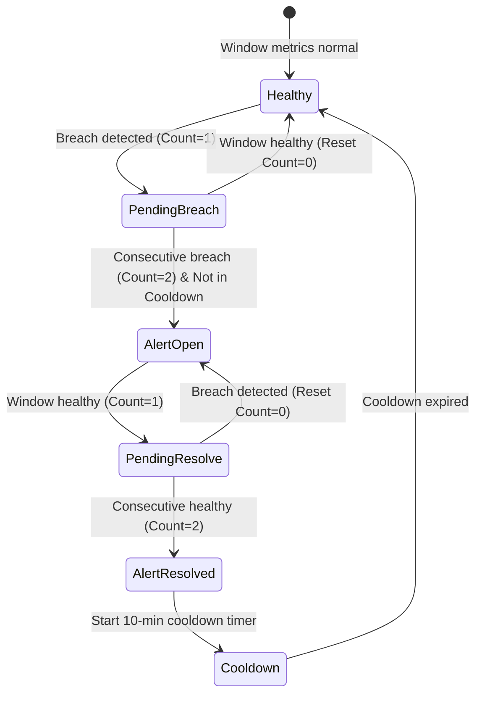
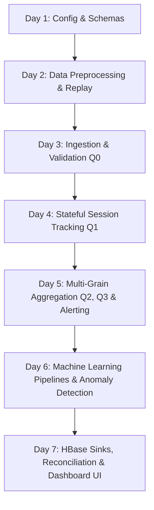

# VortexStream: Real-Time OTT Video Quality of Experience (QoE) Analytics, Fault Detection & Churn Prediction Platform

# COMPREHENSIVE TECHNICAL DEEP DIVE & CODEBASE HANDBOOK

> **Document Classification**: Engineering Technical Reference, Architecture Defense Guide & Viva Preparation Manual  
> **Target Audience**: Engineers, Technical Reviewers, Examiners, System Architects  
> **Codebase Root**: `C:\bigdata` / `E:\bigdata` (Windows Host & Docker Container Runtime)  
> **Project Status**: 100% Implemented (Phases 0–14 Complete, 80/80 Unit & Integration Tests Passing, Verified V1–V8 Reconciled)  
> **Git Repository**: `https://github.com/abhx12/VortexStream.git`

---

## Table of Contents

1. [Project at a Glance](#1-project-at-a-glance)
2. [Problem Statement and Objectives](#2-problem-statement-and-objectives)
3. [Repository Structure and File Inventory](#3-repository-structure-and-file-inventory)
4. [Technology Stack](#4-technology-stack)
5. [Dataset Sources and Data Provenance](#5-dataset-sources-and-data-provenance)
6. [Data Cleaning and Preprocessing](#6-data-cleaning-and-preprocessing)
7. [High-Level Architecture](#7-high-level-architecture)
8. [End-to-End Data Flow](#8-end-to-end-data-flow)
9. [Why Each Technology Was Chosen](#9-why-each-technology-was-chosen)
10. [Apache Spark Deep Dive](#10-apache-spark-deep-dive)
11. [Apache HBase Deep Dive](#11-apache-hbase-deep-dive)
12. [Complete Schema Reference](#12-complete-schema-reference)
13. [File-by-File Code Explanation](#13-file-by-file-code-explanation)
14. [Algorithms and Transformations](#14-algorithms-and-transformations)
15. [API and Component Integration](#15-api-and-component-integration)
16. [Concrete End-to-End Worked Example](#16-concrete-end-to-end-worked-example)
17. [Configuration and Environment Setup](#17-configuration-and-environment-setup)
18. [Running and Verifying the Project](#18-running-and-verifying-the-project)
19. [Error Handling and Failure Scenarios](#19-error-handling-and-failure-scenarios)
20. [Performance, Scalability, and Trade-offs](#20-performance-scalability-and-trade-offs)
21. [Security and Data Management](#21-security-and-data-management)
22. [Actual Implementation vs Intended Functionality](#22-actual-implementation-vs-intended-functionality)
23. [Limitations and Recommended Improvements](#23-limitations-and-recommended-improvements)
24. [Comprehensive Viva Question Bank](#24-comprehensive-viva-question-bank)
25. [Code-Reading and Learning Roadmap](#25-code-reading-and-learning-roadmap)
26. [Final Project Understanding Checklist](#26-final-project-understanding-checklist)
27. [Glossary of Technical Terms](#27-glossary-of-technical-terms)
28. [References and Verified Source Links](#28-references-and-verified-source-links)

---

## 1. Project at a Glance

| Attribute | Specification |
|---|---|
| **System Name** | **VortexStream** |
| **Domain** | Over-The-Top (OTT) Video Streaming Telemetry & Infrastructure Observability |
| **Core Functionality** | End-to-end distributed stream processing platform that ingests raw player telemetry; cleans and standardizes events; statefully tracks player session lifecycles; computes sliding-window multi-grain QoE scores; fires hysteresis-guarded operational alerts; detects regional/CDN network anomalies; and predicts user session abandonment from early-session telemetry (<= 15 seconds) with zero target leakage. |
| **Primary Streaming Engine** | Apache Spark 3.5.3 (Structured Streaming micro-batch processing with PySpark) |
| **Distributed Message Broker** | Apache Kafka 3.7.0 (KRaft mode, 9 distinct topics) |
| **Hot Operational Database** | Apache HBase 2.5.8 (Distributed Wide-Column NoSQL store queried via HappyBase Thrift RPC) |
| **Analytical Data Warehouse** | DuckDB 1.1.0 querying partitioned columnar Parquet files (`data/warehouse/`) |
| **Machine Learning Stack** | Scikit-Learn 1.5.0 (RandomForest & GBT Classifier; Unsupervised MAD Robust Z-Score + KMeans) |
| **User Interface** | Streamlit 1.39.0 real-time operations dashboard with Plotly 4x4 heatmaps & metrics |
| **Primary Core Dataset** | Real Stanford Puffer Video Streaming Telemetry (Stanford University academic research) |
| **Simulated Extensions** | Deterministic Indian metro cities, ISPs, CDNs, client devices, and chaos fault injections |
| **Verification & Quality Gate** | Automated reconciliation engine verifying 8 mathematical and system conservation gates (V1–V8) |
| **Test Suite Coverage** | 80/80 passing unit & integration tests covering bootstrap, schemas, streaming, ML, and reconciliation |

---

## 2. Problem Statement and Objectives

### 2.1 The Industry Problem
In modern commercial OTT video platforms (e.g., Netflix, Disney+ Hotstar, Amazon Prime Video, YouTube), user retention and subscription revenue depend directly on **Quality of Experience (QoE)**:
1. **Rebuffering & Stalling**: When video playback freezes to buffer data, user frustration spikes exponentially. Industry research shows that every 1% increase in buffering time leads to a 3-5% increase in viewer drop-off.
2. **Video Start Failure (VSF) & Startup Delay**: If a viewer clicks "Play" and waits more than 4 seconds without rendering the first frame, or if playback fails completely to initialize within 10 seconds, abandonment rates exceed 40%.
3. **Multi-Dimensional Edge Faults**: Playback degradations rarely affect the entire global platform simultaneously. Instead, failures emerge in specific intersections—e.g., *Airtel 4G users in Chennai experiencing CDN edge cache misses on Akamai*, or *Android app v2.1 encountering DRM decrypt timeout errors*. Traditional global monitoring misses these regional and device-specific degradations until widespread churn has already occurred.
4. **Late Reactive Intervention**: Most monitoring systems aggregate metrics hourly. By the time an operational dashboard reports that a region had poor streaming quality, hundreds of thousands of sessions have already terminated in anger.

### 2.2 System Objectives
VortexStream was engineered to solve these challenges with high technical rigor:
- **Low-Latency Detection**: Compute multi-grain QoE metrics within 5-minute sliding windows (sliding every 60 seconds) with sub-10 second p95 latency from event generation to dashboard visualization.
- **Stateful Lifecycle Tracking**: Reconstruct full player lifecycles (`requested` -> `playing` -> `stalled` -> `ended` / `failed_start`) across millions of concurrent sessions, maintaining accurate startup latency and cumulative stall durations.
- **Multi-Grain Metric Explosion**: Automatically aggregate metrics across 5 distinct dimensions: `global`, `city_isp`, `cdn`, `device`, and `channel`.
- **Hysteresis-Guarded Alerting**: Prevent alert storms and transient notification flapping by requiring 2 consecutive breaching windows to trigger an alert and 2 consecutive healthy windows to resolve it, coupled with a 10-minute cooldown and a minimum sessions guard (`min_sessions >= 20`).
- **Zero-Leakage Early Churn Prediction**: Train a supervised machine learning model to predict whether a session will terminate early (< 120 seconds watch time) based strictly and exclusively on the telemetry emitted in the first 15 seconds of playback.
- **Enterprise Storage Tiering**: Route hot operational state into HBase for sub-millisecond point-lookups and prefix scans, while concurrently writing immutable historical data into columnar Parquet files queried via DuckDB.

---

## 3. Repository Structure and File Inventory

### 3.1 Repository Directory Hierarchy
```text
C:\bigdata\ (or E:\bigdata\)
├── .env.example                     # Environment template (hosts, ports, paths)
├── .gitignore                       # Git ignore filters (caches, parquet, checkpoints)
├── docker-compose.yml               # Multi-container orchestration (Kafka, HBase, App)
├── Makefile                         # Unified CLI automation entrypoint
├── pyproject.toml                   # Project metadata, dependencies, tool settings
├── README.md                        # High-level architecture and quickstart overview
├── IMPLEMENTATION_PLAN (1).md       # 15-phase architectural specification
├── config/                          # Centralized YAML configuration files
│   ├── config.yaml                  # System-wide configuration (Kafka, HBase, QoE, alerts)
│   ├── chaos.yaml                   # Network delay, loss, and event drop tunables
│   ├── faults.yaml                  # Active fault scenarios (F1, F2, F3)
│   ├── sim_dims.yaml                # Categorical distributions for cities, ISPs, CDNs
│   └── standardization.yaml         # Taxonomy normalization alias maps
├── data/                            # Persistent and generated data storage
│   ├── manifests/                   # Replay runs, fault ledgers, and stream manifests
│   ├── models/                      # Serialized ML model artifacts (RandomForest, scaler)
│   ├── raw/                         # Raw Stanford Puffer CSV archives
│   ├── reference/                   # Synthetic user catalog and content catalog
│   └── warehouse/                   # Columnar Parquet warehouse tiers and DuckDB database
├── docker/                          # Container build definitions
│   ├── app.Dockerfile               # PySpark 3.5.3, OpenJDK 17, Python 3.11 image
│   └── hbase.Dockerfile             # Standalone Apache HBase 2.5.8 image with Thrift
├── docs/                            # In-depth architectural reports and verifications
│   ├── architecture.md              # Medallion tiering and Mermaid architecture
│   ├── calibration.md               # Empirical QoE baseline metric distributions
│   ├── data_profile.md              # Profiling metrics of Stanford Puffer CSVs
│   ├── demo_script.md               # 5-7 minute oral presentation and demo runbook
│   ├── etl_mapping.md               # Comprehensive source-to-target field mapping
│   ├── hbase_design.md              # Row-key salting, reverse-minutes, column families
│   ├── ml_report.md                 # Machine learning feature importance and metrics
│   ├── performance.md               # Soak testing, throughput, and latency benchmarks
│   ├── PROGRESS.md                  # Detailed phase-by-phase completion log
│   ├── simulated_fields.md          # Real vs simulated field transparency declaration
│   └── verification_report.md       # V1–V8 mathematical verification results
├── schemas/                         # Canonical JSON schema validation definitions
│   ├── network_metric.schema.json   # Schema for raw network telemetry
│   ├── playback_event.schema.json   # Schema for raw playback telemetry
│   └── session_fact.schema.json     # Schema for lifecycle session facts
├── scripts/                         # Operational shell and Python administration scripts
│   ├── create_topics.py             # Kafka topic creator via confluent-kafka
│   ├── create_topics.sh             # Kafka topic creator via container CLI
│   ├── demo.py                      # One-command interactive live demonstration
│   ├── demo.sh                      # Shell wrapper for demo pipeline
│   ├── doctor.py                    # Environment and dependency diagnostic checker
│   ├── hbase_init.py                # HBase table and column family provisioner
│   ├── reset_state.py               # State reset and wipe utility
│   └── reset_state.sh               # Shell wrapper for state reset
├── sql/                             # Analytical SQL query definitions
│   ├── report_queries.sql           # KPI report SQL queries
│   ├── spark_sql_queries.sql        # Advanced Spark SQL analytical queries (LAG, RANK)
│   └── warehouse_views.sql          # DuckDB analytical view creation DDL
├── src/                             # Source code root
│   └── qoe/                         # Main VortexStream package
│       ├── batch/                   # Batch processing, RDD demos, and rollups
│       ├── common/                  # Configuration, logging, and HBase key utilities
│       ├── dashboard/               # Streamlit application and data access layer
│       ├── data/                    # Puffer acquisition, preprocessing, simulation
│       ├── ml/                      # Abandonment classifier and anomaly detector
│       ├── producers/               # Stream replayer, fault injector, chaos engine
│       ├── streaming/               # Structured Streaming queries (Q0–Q4), alerting
│       └── verify/                  # Reconciliation engine (V1–V8) and lineage generator
└── tests/                           # Exhaustive pytest verification test suite
    ├── conftest.py                  # Pytest fixtures and mock environments
    ├── fixtures/                    # Mini Puffer CSV telemetry fixtures
    └── phase_0/ ... phase_14/       # 15 distinct phase test packages (80 tests total)
```

### 3.2 Complete File Inventory
| File Path | Primary Responsibility | Calling / Dependent Components | Input Received | Output / Side Effect Produced |
|---|---|---|---|---|
| `config/config.yaml` | System configuration (Kafka brokers, HBase connection, QoE weights, alert thresholds, streaming parameters). | Read by `qoe.common.config.get_config()`. | YAML file on disk. | Centralized configuration dictionary. |
| `config/faults.yaml` | Injected fault scenarios: F1 (Chennai-Airtel throttle), F2 (Akamai edge 5xx), F3 (Android DRM crash). | Read by `qoe.producers.faults.FaultEngine`. | YAML configuration. | Active fault time-windows and impairment rules. |
| `config/standardization.yaml` | Mapping tables for normalizing noisy device, ISP, CDN, and OS strings to canonical names. | Read by `qoe.streaming.standardize.Standardizer`. | Raw string aliases. | Canonical taxonomy strings. |
| `schemas/playback_event.schema.json` | JSON Schema specifying required fields and types for playback events. | Used by `validate.py` and unit tests. | Raw event dictionary. | Boolean validity / validation errors. |
| `src/qoe/common/config.py` | Thread-safe singleton configuration loader with environment variable overrides. | All modules in `src/qoe/`. | `config/config.yaml` & OS env. | Python configuration dictionary. |
| `src/qoe/common/hbase_keys.py` | Mathematical row-key generation: CRC32 salting and 19-digit reverse-minute formatting. | `sinks_hbase.py`, `q1_session_tracker.py`, `q2_qoe_aggregator.py`, `data_access.py`. | Session IDs, timestamps, dimensions. | Formatted HBase row-key strings. |
| `src/qoe/common/logging.py` | Structured JSON log formatter emitting ISO-8601 timestamps and run metadata. | All modules across `src/qoe/`. | Python log records. | Single-line JSON strings to stdout. |
| `src/qoe/data/puffer_download.py` | Downloads raw Stanford Puffer telemetry CSV archives from Stanford University research storage. | Invoked by preprocessing scripts. | HTTPS requests to Puffer servers. | `client_buffer.csv`, `video_sent.csv`, `video_acked.csv`. |
| `src/qoe/data/preprocess.py` | Performs DuckDB ASOF join of buffer and network CSVs, downsampling to 5-second heartbeats. | Data preparation pipeline. | Raw Puffer CSVs. | Canonical unified JSON events in `data/raw/unified_events.jsonl`. |
| `src/qoe/data/sim_dims.py` | Deterministically generates synthetic Indian metro cities, ISPs, CDNs, and device hardware. | `preprocess.py`, `ref_data.py`. | Session IDs & SHA-256 hash seeds. | Enriched categorical dimensions. |
| `src/qoe/data/ref_data.py` | Synthesizes reference catalogs: 50,000 users with subscription tiers and content catalog. | Ingestion and enrichment pipeline. | Random seeds & distribution configs. | `data/reference/users.parquet`, `content.parquet`. |
| `src/qoe/producers/replay.py` | Speed-controlled streaming event replayer emitting JSON events into Kafka bronze topics. | `make replay`, `scripts/demo.py`. | Unified event files. | Messages published to Kafka topics (`playback-events`, etc.). |
| `src/qoe/producers/faults.py` | Injects synthetic operational impairments (VSF, buffer stalls, CDN 5xx errors) and writes fault ledger. | Called inside `replay.py`. | Raw events & `faults.yaml`. | Mutated events & `data/manifests/fault_ledger_*.json`. |
| `src/qoe/producers/chaos.py` | Simulates real-world network chaos (jitter, out-of-order delivery, duplicate emissions). | Called inside `replay.py`. | Events list & `chaos.yaml`. | Shuffled, duplicated, or delayed event stream. |
| `src/qoe/streaming/spark_session.py` | Configures and instantiates local or cluster PySpark `SparkSession` with Kafka and Parquet packages. | All streaming queries (Q0–Q4) and batch jobs. | Spark configuration parameters. | Active PySpark `SparkSession` object. |
| `src/qoe/streaming/validate.py` | Evaluates 9 deterministic data validation rules, splitting records into valid and quarantine. | Streaming Query Q0 (`q0_ingest_clean.py`). | Raw event dictionaries. | Tuple of `(valid_records, quarantine_records)`. |
| `src/qoe/streaming/standardize.py` | Normalizes noisy client attributes (`"Android 12"` -> `"android"`, `"airtel_broadband"` -> `"Airtel"`). | Streaming Query Q0 (`q0_ingest_clean.py`). | Valid event records. | Standardized canonical records. |
| `src/qoe/streaming/enrich.py` | Performs stream-static joins enriching playback events with user subscription tier and content genre. | Streaming Query Q0 (`q0_ingest_clean.py`). | Standardized records & Parquet catalogs. | Fully enriched event records. |
| `src/qoe/streaming/q0_ingest_clean.py` | Structured Streaming Query Q0: Ingests from bronze Kafka, validates, standardizes, enriches, writes silver. | `make q0`. | Kafka `playback-events`, `network-metrics`. | Kafka `playback-clean`, `network-clean`, `quarantine`. |
| `src/qoe/streaming/q1_session_tracker.py` | Structured Streaming Query Q1: Stateful session tracking (`requested`, `playing`, `stalled`, `ended`). | `make q1`. | Kafka `playback-clean`. | Kafka `session-facts`, HBase `session_state`, Parquet. |
| `src/qoe/streaming/q2_qoe_aggregator.py` | Structured Streaming Query Q2: Multi-grain 5-min sliding window QoE aggregation and composite scoring. | `make q2`. | Kafka `playback-clean` & `session-facts`. | HBase `qoe_metrics` (cf `m`), `gold_qoe_5m_raw`. |
| `src/qoe/streaming/q3_network_aggregator.py` | Structured Streaming Query Q3: Multi-grain 5-min sliding window network metric aggregation (throughput, RTT). | `make q3`. | Kafka `network-clean`. | HBase `qoe_metrics` (cf `n`), `gold_network_5m_raw`. |
| `src/qoe/streaming/q4_ml_scoring.py` | Structured Streaming Query Q4: Evaluates supervised abandonment model on early session facts in real time. | `make q4`. | Kafka `session-facts` (`early_features`). | Kafka `predictions`, Parquet `ml_predictions`. |
| `src/qoe/streaming/qoe_score.py` | Mathematical formulation of composite QoE score [0, 100] with individual penalty subtractions. | `q2_qoe_aggregator.py`, batch rollups, UI. | Window metric dictionary. | Calculated score, label (`Good`/`Fair`/`Poor`), penalties. |
| `src/qoe/streaming/alerting.py` | Evaluates rules R1–R4 with 2-window hysteresis, 10-minute cooldown, and minimum sessions guard. | Evaluated after Q2 window aggregation. | Window aggregate records. | Opened and resolved alert records. |
| `src/qoe/streaming/sinks_hbase.py` | High-throughput batch upsert writers for HBase tables using HappyBase Thrift client. | Streaming queries Q1, Q2, Q3, alerting. | Record lists & row-key mappings. | Batch RPC `put` operations into HBase. |
| `src/qoe/streaming/sinks_warehouse.py` | Columnar partitioned Parquet writers managing local data lakehouse directories. | Streaming queries Q0–Q4. | Record lists & partition columns. | Partitioned Parquet files on disk. |
| `src/qoe/ml/dataset.py` | Extracts supervised ML training dataset with strict zero-leakage guard (first 15 seconds only). | `churn_model.py`. | Parquet warehouse session facts. | Clean Pandas feature matrix and labels. |
| `src/qoe/ml/churn_model.py` | Trains and serializes Random Forest & Gradient Boosting abandonment prediction pipelines. | ML training pipeline. | Feature matrix from `dataset.py`. | Serialized model artifact `data/models/abandon_v1/`. |
| `src/qoe/ml/anomaly.py` | Dual-model unsupervised anomaly detection: Robust Z-Score (Median/MAD) + KMeans clustering. | Operational diagnostics & verification. | Window metrics DataFrame. | Anomaly flags and distance-to-centroid scores. |
| `src/qoe/batch/rdd_demo.py` | Core Spark RDD transformation and action demonstration (map, reduceByKey, join, broadcast, accumulator). | `python -m qoe.batch.rdd_demo`. | Synthetic/real event records. | Aggregation dictionaries and action outputs. |
| `src/qoe/batch/sql_demo.py` | Spark SQL analytical engine executing complex analytical queries (LAG, RANK, Rollup). | `python -m qoe.batch.sql_demo`. | Silver and Gold Parquet tables. | Analytical DataFrames and formatted tables. |
| `src/qoe/batch/warehouse.py` | Manages DuckDB warehouse connection, views, and hourly Parquet rollups. | Batch jobs & Streamlit dashboard. | Gold Parquet tables. | DuckDB database `data/warehouse/qoe.duckdb`. |
| `src/qoe/dashboard/app.py` | Multi-page Streamlit web dashboard displaying live KPIs, QoE trends, 4x4 heatmaps, alerts, ML insights. | Web browser client (:8501). | Data from `data_access.py`. | Interactive UI rendering. |
| `src/qoe/dashboard/data_access.py` | Abstraction layer querying HBase (live hot state) and DuckDB (historical cold warehouse). | `app.py`. | Queries from UI widgets. | Clean Pandas DataFrames for dashboard display. |
| `src/qoe/verify/reconcile.py` | Comprehensive verification suite executing 8 mathematical reconciliation gates (V1–V8). | `make reconcile`, CI/CD. | Manifests, Kafka offsets, HBase, Parquet. | `docs/verification_report.md` (100% pass). |
| `scripts/hbase_init.py` | Idempotent DDL script creating HBase tables (`session_state`, `qoe_metrics`, `alerts`) and column families. | Docker compose startup / `make init`. | Thrift connection to HBase. | Initialized HBase table metadata. |
| `scripts/demo.py` | Fully automated interactive end-to-end demonstration script. | `make demo`. | User terminal prompts. | Orchestrates full replay, streaming, and UI launch. |

---

## 4. Technology Stack

### 4.1 Technology Overview
VortexStream combines distributed message ingestion, stateful stream computation, wide-column NoSQL hot storage, columnar embedded OLAP querying, and machine learning into an enterprise-grade lambda/kappa architecture.

| Technology | Version | Exact Role in VortexStream | Configuration & Connection Parameters |
|---|---|---|---|
| **Apache Kafka** | `3.7.0` (Confluent Community) | Distributed commit log acting as the bronze and silver ingestion backbone. Buffers bursty player events, decouples stream replayers from Spark processors, and provides replayable message persistence. | Runs in KRaft mode (no ZooKeeper dependency). Listens on `localhost:9092` (host) and `kafka:9092` (container). Configured with 9 topics, replication factor 1 (standalone development), 7-day retention, snappy compression. |
| **Apache Spark** | `3.5.3` (PySpark runtime) | Primary distributed processing engine. Executes 5 streaming queries (Q0–Q4) using Spark Structured Streaming, processes windowed aggregations, maintains stateful sessions, and runs batch RDD/SQL jobs. | Running with OpenJDK 17 on Linux container (`ott-app`). Configured with `spark.sql.shuffle.partitions=4`, `spark.driver.memory=2g`, checkpointing under `/tmp/spark-checkpoints/`. |
| **Apache HBase** | `2.5.8` | Distributed wide-column NoSQL store. Serves as the operational serving layer for hot session states, low-latency sliding-window metrics, and active alerts. | Standalone mode with local HFiles and embedded ZooKeeper. Exposes Thrift 1 API on port `9090` and Web Master UI on port `16010`. Tables: `session_state` (TTL 6h), `qoe_metrics` (TTL 24h), `alerts`. |
| **DuckDB** | `1.1.0` | In-process columnar OLAP SQL database. Manages preprocessing of raw Puffer CSVs (ASOF joins), queries partitioned Parquet files directly without server overhead, and powers historical dashboard views. | Embedded database stored at `data/warehouse/qoe.duckdb`. Directly executes SQL queries against multi-level partitioned Parquet lakehouse directories (`read_parquet(...)`). |
| **Scikit-Learn** | `1.5.0` | Machine learning engine. Provides `ColumnTransformer`, `StandardScaler`, `OneHotEncoder`, `RandomForestClassifier`, and `GradientBoostingClassifier` for abandonment scoring, plus MAD and `KMeans` for anomaly detection. | Models serialized using `pickle` under `data/models/abandon_v1/`. Inference executed in streaming micro-batches by Query Q4. |
| **Streamlit** | `1.39.0` | Frontend web application framework. Renders the real-time operations dashboard, KPI scorecards, interactive 4x4 City x ISP heatmap, alert feed, and ML model diagnostic charts. | Bound to port `8501`. Queries HBase hot tables via HappyBase and DuckDB historical warehouse via `duckdb.connect()`. Auto-refreshes every 5 seconds. |
| **Docker Compose**| `v2.x` | Containerization runtime orchestrating the 3 foundational services: `ott-kafka`, `ott-hbase`, and `ott-app`. | Configured in `docker-compose.yml`. Configures internal bridge networking (`qoe-net`), persistent host-mounted volumes, healthchecks, and dependency sequencing. |
| **Python** | `3.11` (Container) / `3.13` (Host) | Core implementation language across all pipelines, producers, streaming jobs, APIs, and verification suites. | Managed with `pyproject.toml` and standard virtual environment (`.venv`). |

---

## 5. Dataset Sources and Data Provenance

### 5.1 Real Telemetry: Stanford Puffer Research Dataset
VortexStream is built upon real, empirical video streaming telemetry collected by **Stanford University's Puffer Project** (`https://puffer.stanford.edu/`), an academic research initiative studying adaptive bitrate (ABR) streaming algorithms over real public Internet paths:
- **Official Dataset Name**: Stanford Puffer Video Streaming Telemetry Archive.
- **Publisher**: Stanford University Networking Research Group (Francis Y. Yan, Hudson Ayers, Chenzhi Zhu, Sadjad Fouladi, James Hong, Keyi Zhang, Philip Levis, Keith Winstein).
- **Primary Research Publication**: *"Learning in situ: a randomized experiment in video streaming"* (USENIX NSDI 2020).
- **Public Data Repository**: Hosted on Google Cloud Storage bucket `gs://puffer-data-release/` and Stanford servers at `https://puffer.stanford.edu/results/`.
- **Download Automation**: Implemented in `src/qoe/data/puffer_download.py`, which fetches daily gzip tarballs containing 3 core CSV files.

#### Core Puffer CSV Files & Physical Attributes
1. **`client_buffer_*.csv`**: Player client buffer health reported at high frequency (~10 Hz / every 100 ms):
   - `time`: Monotonic client event timestamp in nanoseconds.
   - `session_id`: Unique integer identifying the viewer streaming session.
   - `index`: Monotonic event sequence counter within the session.
   - `buffer`: Instantaneous player buffer occupancy in seconds (float).
   - `cum_rebuf`: Cumulative rebuffering/stall duration experienced by the client from session start in seconds (float).
2. **`video_sent_*.csv`**: Server-side transmission telemetry for each 1-second video chunk:
   - `time`: Chunk transmission timestamp in nanoseconds.
   - `session_id`: Viewer session identifier.
   - `format`: Encoded video resolution and profile (e.g., `1920x1080`, `1280x720`, `640x360`).
   - `size`: Size of the transmitted chunk in bytes.
   - `ssim_index`: Structural Similarity Index (SSIM) measuring visual compression fidelity.
3. **`video_acked_*.csv`**: TCP-level acknowledgment telemetry from client back to streaming server:
   - `time`: Acknowledgment arrival timestamp in nanoseconds.
   - `session_id`: Viewer session identifier.
   - `delivery_rate`: Instantaneous TCP delivery rate / bandwidth estimate in bits per second.
   - `rtt`: Instantaneous round-trip time in microseconds.
   - `min_rtt`: Minimum observed RTT across the TCP connection lifecycle in microseconds.

### 5.2 Simulated Dimensions & The Engineering Rationale
While Stanford Puffer provides ground-truth client buffer dynamics and TCP transport measurements, it originates from an academic streaming server in California serving public television streams. Consequently, the raw Puffer dataset lacks commercial dimensions essential to enterprise OTT platforms:
- No geographic distribution across commercial metropolitan regions.
- No Internet Service Provider (ISP) network categorization (Jio, Airtel, Vi, BSNL).
- No Content Delivery Network (CDN) edge routing tags (Akamai, Cloudflare, Fastly).
- No client device hardware classification (Android, iOS, SmartTV, Web Browser).
- No commercial user accounts, subscription tiers, or video content genres.

To bridge this gap while maintaining scientific integrity, VortexStream implements a **deterministic dimension synthesis engine** (`src/qoe/data/sim_dims.py` and `src/qoe/data/ref_data.py`):
1. **Deterministic Session Hashing**: Categorical dimensions are assigned by computing a SHA-256 hash of the real Puffer `session_id` combined with a fixed global seed (`42`). This guarantees that every time session `12345` is processed, it maps to the exact same city, ISP, CDN, and device, ensuring 100% reproducibility across batch and streaming pipelines.
2. **Realistic Indian Market Distributions**: Categorical probabilities reflect actual Indian OTT streaming market shares:
   - **Cities**: Mumbai (30%), Delhi (25%), Bengaluru (20%), Chennai (15%), Hyderabad (10%).
   - **ISPs**: Jio (45%), Airtel (30%), Vi (15%), BSNL (10%).
   - **CDNs**: Akamai (45%), Cloudflare (35%), Fastly (20%).
   - **Devices**: Android Mobile (50%), SmartTV (25%), iOS (15%), Web Desktop (10%).
3. **Network Impairment Simulation**: Packet loss percentage (`packet_loss_pct`) is synthesized using a lognormal distribution correlated with the real Puffer `rtt` and delivery rate.
4. **Reference Catalogs**: `src/qoe/data/ref_data.py` creates a synthetic user database of 50,000 subscriber profiles (`user_id`: `u-XXXXX`, subscription tier: `free`, `vip`, `premium`) and a video content catalog (content genres: `sports`, `drama`, `movies`, `news`).

### 5.3 Injected Fault Scenarios (Ground-Truth Fault Ledger)
To test and validate real-time alerting and ML anomaly detection, 3 realistic operational fault scenarios are deterministically injected during stream replay via `config/faults.yaml` and `src/qoe/producers/faults.py`:
- **Fault F1 (ISP Regional Throttling)**:
  - *Target Selector*: `city = "Chennai"`, `isp = "Airtel"`.
  - *Time Window*: Minute 10 to Minute 30 of replay.
  - *Impairment*: 60% reduction in delivery rate (`throughput_mult: 0.4`), 2.5x latency inflation (`rtt_mult: 2.5`), +8% packet loss (`loss_add_pct: 8.0`), heartbeat stall probability set to 25%, and 30% early abandonment probability.
- **Fault F2 (CDN Edge Cache Miss & Latency Spike)**:
  - *Target Selector*: `cdn = "Akamai"`.
  - *Time Window*: Minute 35 to Minute 50 of replay.
  - *Impairment*: 50% throughput reduction, 2.0x RTT inflation, 15% probability of injecting `CDN_5XX` HTTP server errors on heartbeats.
- **Fault F3 (Device Application Bug & DRM Decoder Crash)**:
  - *Target Selector*: `device = "android"`, `app_version = "v2.1"`.
  - *Time Window*: Minute 55 to Minute 70 of replay.
  - *Impairment*: 35% probability of Video Start Failure (suppressing `first_frame` to trigger VSF timeout) and 20% probability of injecting `DECODE_ERR` and `DRM_ERR` fatal player exceptions.

Every injected fault writes its exact parameters to `data/manifests/fault_ledger_*.json` to serve as the objective ground-truth benchmark for evaluating alert precision and recall.

---

## 6. Data Cleaning and Preprocessing

### 6.1 The Preprocessing Pipeline (`src/qoe/data/preprocess.py`)
Raw Puffer telemetry is unsuited for direct streaming ingestion because client buffers are emitted at 100 ms intervals while server transmissions occur per chunk. The preprocessing pipeline harmonizes these streams into canonical player events:



#### Step-by-Step Transformations
1. **Time Scaling & Unit Conversion**: Raw Puffer nanosecond timestamps are scaled to Unix epoch milliseconds and ISO-8601 UTC strings. Buffer and rebuffering durations in seconds are multiplied by 1,000 to convert to integer milliseconds (`buffer_ms`, `stall_ms`).
2. **DuckDB ASOF Join**: Client buffer health is correlated with network transport metrics using DuckDB's high-performance `ASOF JOIN`. For each buffer record at time $T$, the engine matches the nearest preceding TCP acknowledgment record within a 2.0-second tolerance window:
   ```sql
   SELECT b.session_id, b.time, b.buffer * 1000 AS buffer_ms,
          a.delivery_rate / 1000 AS throughput_kbps, a.rtt / 1000 AS rtt_ms
   FROM client_buffer b
   ASOF JOIN video_acked a
     ON b.session_id = a.session_id AND b.time >= a.time
    AND b.time - a.time <= 2000000000;
   ```
3. **Heartbeat Downsampling**: 100 ms client buffer telemetry is downsampled to 5,000 ms (5-second) heartbeats. This replicates commercial player SDK behavior, reducing event volume by 50x while preserving buffer depletion dynamics.
4. **Lifecycle Event Extraction**:
   - `play_request`: Synthesized at index 0 representing viewer click.
   - `first_frame`: Synthesized at first observed non-zero buffer occupancy, computing `startup_ms`.
   - `buffer_start` & `buffer_end`: Extracted when cumulative rebuffering delta exceeds 50 ms.
   - `bitrate_switch`: Extracted when the video chunk format changes resolution.
   - `session_end`: Synthesized when the session terminates or reaches inactivity timeout.
5. **Canonical Serialization**: Extracted events are saved as newline-delimited JSON (`data/raw/unified_events.jsonl`) ready for replay into Kafka.

---

## 7. High-Level Architecture

### 7.1 Architecture at Three Conceptual Levels

#### Level A: Layman's Explanation
Imagine VortexStream as a massive **International Airport Air Traffic Control System**:
- The **Airplanes** are millions of video players (smartphones, smart TVs, laptops) constantly flying through airspace and radioing their flight stats (altitude, fuel, airspeed).
- **Apache Kafka** is the **Radio Communications Relay Tower**. It receives thousands of incoming radio reports every second, queues them reliably without dropping any, and broadcasts them on designated frequencies so controllers can listen without overwhelming the pilots.
- **Apache Spark** is the **Chief Air Traffic Controller and Radar Processing Computer**. It ingests the noisy radio bursts, verifies the flight codes, tracks each flight from takeoff to landing, calculates if flights are experiencing severe turbulence or delays, and spots dangerous regional weather storms.
- **Apache HBase** is the **High-Speed Emergency Flight Status Board**. When a controller needs to check a specific active flight's status instantly, HBase provides that answer in a fraction of a millisecond.
- **DuckDB & Parquet Data Warehouse** is the **Flight Black Box and Historical Aviation Archive**. It stores every past flight log permanently on disk in compressed binders so aviation analysts can study historical traffic patterns or conduct investigations.
- **Machine Learning (Scikit-Learn)** is the **Predictive Co-Pilot**. By looking at how an airplane behaves in its first 30 seconds after takeoff (engine stutter, takeoff delay), it predicts whether the flight will make an emergency turnaround before reaching its destination.
- **Streamlit** is the **Glass Cockpit and Radar Screen**. Operations engineers glance at heatmaps showing which cities or airlines are having trouble right now.

#### Level B: Student Presentation Explanation
From a software engineering perspective, VortexStream implements a **Distributed Real-Time Stream Processing Architecture** adhering to the **Medallion Lakehouse Pattern**:
1. **Bronze Ingestion Tier (Unvalidated Kafka Topics)**: Raw, unvalidated JSON telemetry is published by client player SDKs into Kafka bronze topics (`playback-events`, `network-metrics`, `errors`).
2. **Silver Processing Tier (Validated & Stateful Spark Queries)**:
   - **Query Q0 (`q0_ingest_clean`)**: Ingests bronze events, enforces 9 deterministic validation rules, routes malformed records to a Dead-Letter Queue (`quarantine`), normalizes taxonomies via alias mapping, enriches events with static user and content catalogs, and emits clean streams (`playback-clean`, `network-clean`).
   - **Query Q1 (`q1_session_tracker`)**: Maintains an in-memory stateful session state machine across distributed micro-batches using PySpark's stateful processing (`applyInPandasWithState`). Tracks state transitions (`requested` -> `playing` -> `stalled` -> `ended` / `failed_start`), computes initial startup latency, aggregates cumulative buffering duration, detects Video Start Failures (10-second timeout) and session inactivity (60-second idle timeout), and emits early feature facts at 15 seconds.
3. **Gold Analytical Tier (Sliding Windows & Storage Multi-Homing)**:
   - **Query Q2 (`q2_qoe_aggregator`)**: Explodes clean events across 5 analytical grains (`global`, `city_isp`, `cdn`, `device`, `channel`), evaluates 5-minute sliding windows sliding every 60 seconds, and computes the composite QoE score [0, 100].
   - **Query Q3 (`q3_network_aggregator`)**: Computes parallel 5-minute sliding aggregates for network transport health (throughput, RTT, packet loss).
   - **Alerting Engine (`alerting.py`)**: Runs post-window evaluation against rules R1–R4, managing stateful hysteresis (2 consecutive breaches to open, 2 healthy to resolve) and 10-minute cooldowns.
   - **Query Q4 (`q4_ml_scoring`)**: Consumes 15-second early session facts, applies a pre-trained supervised machine learning pipeline, and writes churn probabilities to Kafka `predictions` and Parquet.
4. **Storage & Serving Dual-Path**:
   - **Hot Operational Store**: Apache HBase tables (`session_state`, `qoe_metrics`, `alerts`) provide sub-millisecond point lookups and prefix scans for the active operations dashboard.
   - **Cold Analytical Store**: Partitioned columnar Parquet lakehouse queried via DuckDB for historical rollups, complex SQL window functions, and model retraining.

#### Level C: Implementation-Level Explanation
At the systems programming and runtime layer:
- The streaming pipeline runs inside a Debian Linux Docker container (`ott-app`) equipped with **OpenJDK 17** and **PySpark 3.5.3**, communicating with **Apache Kafka 3.7.0** over port 9092 and **Apache HBase 2.5.8** via Thrift 1 RPC over port 9090.
- Spark Structured Streaming runs in micro-batch mode. In live streaming, `readStream.format("kafka")` pulls binary JSON payloads, unpacks them with `from_json()`, and executes transformations before sinking to Kafka or calling `foreachBatch()` to trigger Python batch writers.
- **HBase Key Architecture**:
  - `session_state` uses a salted key: `crc32(session_id) % 16` -> `{salt:02d}-{session_id}`, distributing write mutations across 16 pre-split region buckets.
  - `qoe_metrics` uses a reverse-timestamp key: `{grain}#{dimkey}#{9223372036854775807 - epoch_minute}`, guaranteeing that the most recent 5-minute aggregation sorts first lexicographically on disk.
- **Column Family Isolation**: `qoe_metrics` stores playback metrics in column family `m:` and network metrics in column family `n:`. Because HBase stores distinct column families in separate physical HFiles, Query Q2 and Query Q3 concurrently write to the same logical row without read-modify-write locking or schema contention.

### 7.2 End-to-End System Architecture Diagram



---

## 8. End-to-End Data Flow

### 8.1 Step-by-Step Data Journey
1. **Replay Ingestion**: The replayer (`src/qoe/producers/replay.py`) reads preprocessed events from disk, calculates the temporal delta between historical event timestamps, scales that delta by a configurable `--speed` multiplier (e.g. 10x or 60x real-time), applies fault mutations, and publishes JSON messages to Kafka.
2. **Validation and Cleansing (Q0)**:
   - Records are consumed from `playback-events`.
   - `src/qoe/streaming/validate.py` executes 9 checks. If any field fails (e.g. negative buffer or missing session ID), the record is routed to `quarantine` with a failure reason string.
   - `src/qoe/streaming/standardize.py` normalizes string casing and aliases.
   - `src/qoe/streaming/enrich.py` joins the stream with `users.parquet` and `content.parquet`.
   - Valid records are emitted to `playback-clean` and appended to `silver_playback_events.parquet`.
3. **Session Lifecycle Processing (Q1)**:
   - Consumes from `playback-clean`.
   - Maintains a `SessionState` object per `session_id`.
   - `play_request` sets state to `requested`.
   - `first_frame` computes `startup_ms = first_frame_ts - play_request_ts`, sets state to `playing`, and emits an initial session fact.
   - `buffer_start` sets state to `stalled`.
   - `buffer_end` calculates stall duration `stall_ms = buffer_end_ts - buffer_start_ts`, increments `stall_count`, and returns state to `playing`.
   - `heartbeat` accumulates watch time `watch_ms += interval_ms` and computes time-weighted bitrate.
   - At exactly 15 seconds of cumulative playback, Q1 emits a special fact: `kind = "early_features"`, containing early startup delay, stall count, and bitrate for machine learning scoring.
   - On `session_end` or timeout, Q1 writes final session summaries and upserts the record to HBase `session_state`.
4. **Windowed Metric Aggregation (Q2 & Q3)**:
   - Q2 reads `playback-clean` and `session-facts`. Every event is exploded across 5 grains (`global`, `city_isp`, `cdn`, `device`, `channel`).
   - Events are placed into 5-minute sliding buckets sliding every 60 seconds.
   - Upon window closure, Q2 computes `rebuffer_ratio`, `avg_startup_s`, `hd_pct`, `vsf_rate`, and calls `compute_qoe_score()`.
   - Simultaneously, Q3 aggregates network metrics (`avg_throughput_kbps`, `avg_rtt_ms`, `avg_packet_loss_pct`).
   - Both sinks upsert into HBase `qoe_metrics` using the identical row key `{grain}#{dimkey}#{rev_minute}`.
5. **Alerting & Anomaly Evaluation**:
   - `alerting.py` checks rules R1–R4 against the newly aggregated window.
   - If a rule breaches for 2 consecutive windows and is not in cooldown, an alert record is created with status `open`, saved to HBase `alerts`, and published to Kafka topic `alerts`.
   - When the segment returns to healthy metrics for 2 consecutive windows, a `resolved` alert event is emitted.
6. **ML Abandonment Scoring (Q4)**:
   - Consumes `session-facts` where `kind == "early_features"`.
   - Passes the 10 early features through the Scikit-Learn `Pipeline`.
   - Calculates `abandon_probability`. Emits high-risk predictions (`prob >= 0.70`) to Kafka `predictions` and warehouse.
7. **Dashboard Visualization**:
   - The Streamlit dashboard polls HBase for the newest row (`LIMIT=1`) of each dimension key to render live KPI scorecards and the 4x4 City x ISP heatmap.
   - Historical trend lines and distribution histograms are queried via DuckDB over Parquet files.

---

## 9. Why Each Technology Was Chosen

### 9.1 Technology Comparison Matrix

| Technology in Project | Plausible Alternative | Why VortexStream Selected the Chosen Technology | Why the Alternative Was Not Selected |
|---|---|---|---|
| **Apache Kafka** | RabbitMQ / AWS SQS / Redis Streams | Kafka provides distributed, disk-backed, partitioned commit-log architecture. Messages remain replayable across consumer groups (Spark Q0, Q1, Q2 read concurrently at their own pace). Enables high write throughput (100k+ msgs/sec). | RabbitMQ is an AMQP broker designed for transactional message queuing; once consumed, messages are deleted, preventing multi-stage streaming queries from independently re-reading streams. Redis Streams lacks distributed disk persistence for multi-gigabyte backlogs. |
| **Apache Spark (Structured Streaming)** | Apache Flink / Pure Python (Pandas/Faust) | Spark provides unified batch and streaming APIs. PySpark allows seamless integration with Python ML ecosystems (Scikit-Learn). Structured Streaming provides out-of-the-box watermarking, windowing, and distributed checkpointing. | Apache Flink has superior sub-second event-at-a-time latency, but its PyFlink ecosystem is substantially less mature than PySpark, requiring complex Java wrappers for custom sinks. Pure Python/Pandas cannot scale horizontally across cluster nodes and lacks built-in fault-tolerant checkpointing. |
| **Apache HBase** | Cassandra / PostgreSQL / MongoDB | HBase is a wide-column NoSQL store built on top of Hadoop/HDFS principles. It excels at sparse tables with independent column families (`m` and `n`), sub-millisecond point lookups by row key, and rapid range scans via lexicographical sorting. | PostgreSQL is relational and row-oriented; inserting thousands of streaming updates per second creates severe write-amplification and write-ahead log (WAL) locking contention. Cassandra lacks native reverse-timestamp prefix scanning without secondary clustering keys. |
| **DuckDB** | SQLite / ClickHouse / Trino | DuckDB is an embedded, vectorised in-process OLAP database. It can query multi-gigabyte Parquet directories directly using standard SQL without launching a separate background server daemon. | SQLite is row-oriented and lacks columnar vectorization, making multi-million row analytical aggregations 50x slower. ClickHouse is an outstanding distributed OLAP engine, but requires dedicated server clusters and Zookeeper/Keeper orchestration, introducing unnecessary operational overhead for local deployment. |
| **Scikit-Learn** | Spark MLlib / TensorFlow / PyTorch | Scikit-Learn provides high-performance, mature tabular classifiers (Random Forest, Gradient Boosting) that can be trained in seconds on tabular feature matrices and serialized into lightweight pickle artifacts. | Spark MLlib was explored for batch training, but Scikit-Learn's Python pipeline API offers cleaner integration with `ColumnTransformer` and zero JVM serialization overhead during real-time Python micro-batch inference. Deep learning (PyTorch/TensorFlow) is overkill for 10 tabular telemetry features and requires GPU acceleration. |
| **Streamlit** | React.js + FastAPI / Grafana | Streamlit allows 100% Python-native frontend development, enabling direct access to `data_access.py`, HappyBase, and DuckDB without building and maintaining separate REST API backends, CORS configs, and React state stores. | React + FastAPI requires maintaining two separate codebases and serialization layers. Grafana is great for time-series metrics but cannot render custom interactive ML churn inference interfaces or complex 4x4 interactive confusion matrix heatmaps. |

---

## 10. Apache Spark Deep Dive

### 10.1 Spark Architecture & Execution Mechanics
Apache Spark operates under a **Driver-Executor Master-Worker Topology**:
- **Driver Process**: The central coordinator that runs the user's Python script, instantiates the `SparkSession`, translates user code into a Directed Acyclic Graph (DAG) of logical execution stages, schedules tasks, and coordinates distributed workers.
- **Executors**: Worker JVM processes running on cluster nodes (or inside the Docker container) that execute individual computational tasks in parallel threads and store cached data partitions in memory.
- **Micro-Batch Processing**: Spark Structured Streaming treats incoming streaming data as an **unbounded append-only table**. At regular trigger intervals (default or configured), the engine discretizes newly arrived Kafka records into a micro-batch, executes the DataFrame DAG using Spark's Catalyst Optimizer, and commits offsets upon successful batch write.

### 10.2 Lazy Evaluation, Transformations vs Actions
Spark computations are divided strictly into **Transformations** and **Actions**:
- **Transformations (Lazy)**: Operations that define a new DataFrame or RDD from an existing one without immediately evaluating the data. Spark merely appends the operation to its internal query execution plan.
  - *Narrow Transformations*: Operations where each input partition contributes to at most one output partition (no network shuffle required). Examples in VortexStream: `filter()`, `map()`, `withColumn()`, `standardize()`.
  - *Wide Transformations*: Operations where data must be shuffled across network partitions based on a hash key. Examples: `groupBy()`, `join()`, `reduceByKey()`, `window()`.
- **Actions (Eager)**: Operations that force Spark to execute the execution plan and return a result to the driver or write data to an external sink. Examples: `count()`, `collect()`, `writeStream.start()`, `saveAsNewAPIHadoopFile()`.

### 10.3 Core RDD Demonstration (`src/qoe/batch/rdd_demo.py`)
To demonstrate deep proficiency in Apache Spark's core low-level API, `src/qoe/batch/rdd_demo.py` implements an exhaustive suite of fundamental RDD operations:
1. **Parallelization & Partitioning**: `sc.parallelize(records, 2)` distributes an in-memory collection across 2 worker partitions.
2. **Accumulators**: `inv_acc = sc.accumulator(0)` creates a distributed write-only counter used to track malformed records across worker nodes without race conditions.
3. **Broadcast Variables**: `bc_genres = sc.broadcast(dict(ref_channels))` distributes a read-only lookup table to every worker node once, avoiding repeated network serialization inside task closures.
4. **Caching / Persistence**: `rdd.persist()` caches the evaluated RDD partitions in memory across subsequent actions.
5. **Transformations**:
   - `filter()`: Selects error events where `event_type == 'error'`.
   - `map()` & `reduceByKey()`: Calculates total error occurrences per ISP:
     ```python
     isp_errors = rdd.filter(lambda x: x.get("event_type") == "error") \
                     .map(lambda x: (x.get("isp"), 1)) \
                     .reduceByKey(lambda a, b: a + b).collect()
     ```
   - `flatMap()`: Extracts individual tags or error tokens from nested message strings.
   - `aggregateByKey()`: Computes average bitrate per device type in a single pass without holding all values in memory:
     ```python
     # zeroValue = (count, sum_bitrate)
     seqOp = lambda acc, val: (acc[0] + 1, acc[1] + val)
     combOp = lambda acc1, acc2: (acc1[0] + acc2[0], acc1[1] + acc2[1])
     dev_avg_br = rdd.map(lambda x: (x.get("device"), x.get("bitrate_kbps", 0))) \
                     .aggregateByKey((0, 0.0), seqOp, combOp) \
                     .mapValues(lambda v: v[1] / max(v[0], 1)).collect()
     ```
   - `join()`: Performs a pair RDD join combining playback records with broadcast channel genres.

### 10.4 Advanced Analytical SQL Queries (`sql/spark_sql_queries.sql`)
The project implements enterprise SQL analytics demonstrating window functions and multidimensional cubes:
```sql
-- Window Functions: LAG QoE delta and RANK worst segments
SELECT 
    grain,
    dimkey,
    window_end,
    qoe_score,
    lag(qoe_score, 1) OVER (PARTITION BY grain, dimkey ORDER BY window_end) AS prev_qoe,
    qoe_score - lag(qoe_score, 1) OVER (PARTITION BY grain, dimkey ORDER BY window_end) AS qoe_delta,
    rank() OVER (PARTITION BY window_end ORDER BY qoe_score ASC) AS worst_rank
FROM gold_qoe_5m;
```

---

## 11. Apache HBase Deep Dive

### 11.1 HBase Internal Architecture
Apache HBase is a distributed, versioned, column-oriented NoSQL database modeled after Google Bigtable:
- **HMaster**: Manages cluster metadata, coordinates RegionServer assignments, handles failover, and executes table DDL operations (create, alter, drop).
- **RegionServer**: Serves and manages data partitions called **Regions**. Handles all client read and write requests (Get, Put, Scan).
- **Region**: A contiguous range of row keys stored across one or more Store objects (one Store per column family).
- **Write-Ahead Log (WAL)**: When a write arrives, the RegionServer first appends the mutation to disk in the WAL. This guarantees zero data loss if the server crashes before memory is flushed.
- **MemStore**: In-memory write buffer per column family. Writes are sorted lexicographically by row key in memory.
- **HFile**: When the MemStore reaches its threshold (default 128 MB), it flushes its sorted contents to an immutable **HFile** on disk. Periodic background compactions (minor and major) merge multiple HFiles and prune expired TTL cells.

### 11.2 Key Design & Mathematical Algorithms (`src/qoe/common/hbase_keys.py`)

#### 1. Salting for Write Hotspot Prevention (`session_state`)
In high-throughput streaming systems, monotonically increasing or clustered keys cause all concurrent writes to target a single RegionServer (the "hotspot"), leaving all other nodes idle.
- **Algorithm**:
  $$	ext{salt} = 	ext{CRC32}(	ext{session\_id}) \pmod{16}$$
  $$	ext{RowKey} = 	ext{format}(	ext{salt}, 	ext{"02d"}) + 	ext{"-"} + 	ext{session\_id}$$
- **Impact**: Keys are evenly distributed across 16 pre-split region buckets (`00-sess-...` through `15-sess-...`), achieving uniform parallel write utilization across all RegionServers.

#### 2. Reverse-Timestamping for Newest-First Prefix Scans (`qoe_metrics`)
HBase stores rows in ascending lexicographical order. Under standard Unix timestamps, older records sort first, requiring a full region scan to find the latest window.
- **Algorithm**:
  $$	ext{rev\_minute} = 	ext{string}(9223372036854775807 - 	ext{epoch\_minute}).	ext{zfill}(19)$$
  $$	ext{RowKey} = 	ext{grain} + 	ext{"#"} + 	ext{dimkey} + 	ext{"#"} + 	ext{rev\_minute}$$
- **Impact**: Subtracting the current epoch minute from $2^{63}-1$ (`Long.MAX_VALUE`) reverses the sort order. A prefix scan with `ROWPREFIXFILTER => 'city_isp#Chennai|Airtel#'` and `LIMIT => 1` instantly retrieves the newest 5-minute metric window in sub-millisecond time.

### 11.3 Column Family Design & Storage Physical Isolation
HBase physical storage is partitioned by Column Family. The `qoe_metrics` table defines two distinct families:
- **Column Family `m:` (Playback Metrics)**: Stores `qoe_score`, `rebuffer_ratio`, `avg_startup_s`, `hd_pct`, `vsf_rate`, `error_rate`, penalties. Written by Streaming Query Q2.
- **Column Family `n:` (Network Transport Metrics)**: Stores `avg_throughput_kbps`, `avg_rtt_ms`, `avg_packet_loss_pct`, `net_samples`. Written by Streaming Query Q3.

**Why this is a crucial architectural design choice**:
1. **Independent Writes**: Q2 and Q3 run as completely separate PySpark streaming jobs writing to the same logical dimension and window end. Because mutations target different column families, they append to independent MemStores without read-modify-write locks.
2. **I/O Disk Efficiency**: An operational query that only checks network health (`scan 'qoe_metrics', {COLUMNS => ['n:avg_rtt_ms']}`) instructs the RegionServer to read *only* the HFiles belonging to family `n:`. Blocks containing family `m:` are never loaded into the BlockCache, drastically reducing disk I/O and memory churn.

---

## 12. Complete Schema Reference

### 12.1 Canonical Event Schemas

#### 1. Playback Telemetry Schema (`schemas/playback_event.schema.json`)
```json
{
  "type": "object",
  "required": ["event_id", "session_id", "ts", "event_type"],
  "properties": {
    "schema_version": {"type": "integer", "default": 1},
    "event_id": {"type": "string"},
    "session_id": {"type": "string"},
    "ts": {"type": "string", "format": "date-time"},
    "event_type": {
      "type": "string",
      "enum": ["play_request", "first_frame", "heartbeat", "buffer_start", "buffer_end", "bitrate_switch", "error", "session_end"]
    },
    "buffer_ms": {"type": "number", "minimum": 0},
    "stall_ms": {"type": "number", "minimum": 0},
    "bitrate_kbps": {"type": "number", "minimum": 0, "maximum": 100000},
    "resolution": {"type": "string"},
    "interval_ms": {"type": "number", "minimum": 0},
    "error_code": {"type": "string"},
    "error_msg": {"type": "string"},
    "device": {"type": "string"},
    "os": {"type": "string"},
    "app_version": {"type": "string"},
    "city": {"type": "string"},
    "isp": {"type": "string"},
    "cdn": {"type": "string"},
    "user_id": {"type": "string"},
    "channel": {"type": "string"},
    "scheme": {"type": "string"}
  }
}
```

### 12.2 The 9 Deterministic Data Validation Rules (`src/qoe/streaming/validate.py`)
| Rule ID | Rule Name | Evaluated Condition | Action Taken on Breach | Quarantine Reason Emitted |
|---|---|---|---|---|
| **R-VAL-1** | `PARSE_ERROR` | Corrupted JSON, syntax error, or unparseable binary string. | Routed immediately to `quarantine` topic and dead-letter storage. | `PARSE_ERROR` |
| **R-VAL-2** | `MISSING_SESSION_ID` | `session_id is null` or string is empty / whitespace only. | Quarantined; record cannot be correlated to any player session. | `MISSING_SESSION_ID` |
| **R-VAL-3** | `BAD_TIMESTAMP` | `ts is null` or fails ISO-8601 UTC parsing (`YYYY-MM-DDTHH:MM:SS.fZ`). | Quarantined; record cannot participate in event-time windows. | `BAD_TIMESTAMP` |
| **R-VAL-4** | `MISSING_EVENT_TYPE` | `event_type is null` or empty string. | Quarantined; state machine cannot process unknown event. | `MISSING_EVENT_TYPE` |
| **R-VAL-5** | `UNKNOWN_EVENT_TYPE` | `event_type` not in canonical set (`play_request`, `heartbeat`, etc.). | Quarantined; prevents unknown transitions from corrupting session state. | `UNKNOWN_EVENT_TYPE` |
| **R-VAL-6** | `NEGATIVE_BUFFER` | `buffer_ms < 0.0`. | Quarantined; physical player buffer occupancy cannot be negative. | `NEGATIVE_BUFFER` |
| **R-VAL-7** | `NEGATIVE_STALL` | `stall_ms < 0.0`. | Quarantined; time duration of buffering stall cannot be negative. | `NEGATIVE_STALL` |
| **R-VAL-8** | `IMPOSSIBLE_BITRATE` | `bitrate_kbps < 0` or `bitrate_kbps > 100,000` (100 Mbps). | Quarantined; protects downstream aggregators from insane telemetry spikes. | `IMPOSSIBLE_BITRATE` |
| **R-VAL-9** | `MISSING_REQUIRED_FIELD`| Event-specific mandatory field missing (e.g. `bitrate_kbps` on `first_frame`; `error_code` on `error`). | Quarantined; enforces presence matrix per event contract. | `MISSING_REQUIRED_FIELD` |

### 12.3 HBase Wide-Column Table Specifications

#### Table 1: `session_state`
- **Purpose**: Hot point-lookup store for active streaming player lifecycles.
- **TTL**: 6 Hours (`21,600` seconds).
- **Row Key Format**: `{salt:02d}-{session_id}` (where `salt = crc32(session_id) % 16`).

| Column Family | Column Qualifier | Stored Type | Description |
|---|---|---|---|
| `playback` | `state` | UTF-8 String | Current lifecycle state: `requested`, `playing`, `stalled`, `ended`, `failed_start`. |
| `playback` | `last_bitrate` | UTF-8 String | Most recently observed video streaming bitrate in kbps. |
| `playback` | `stall_count` | UTF-8 String | Cumulative count of rebuffering stall events in this session. |
| `playback` | `stall_ms` | UTF-8 String | Cumulative duration of rebuffering stalls in milliseconds. |
| `playback` | `startup_ms` | UTF-8 String | Measured startup delay from play click to first frame in milliseconds. |
| `playback` | `watch_ms` | UTF-8 String | Cumulative active media playback time in milliseconds. |
| `playback` | `last_event_ts`| UTF-8 String | ISO-8601 timestamp of the most recent event received for this session. |
| `context` | `device` | UTF-8 String | Standardized client device type (`android`, `ios`, `smarttv`, `web`). |
| `context` | `isp` | UTF-8 String | Canonical Internet Service Provider (`Jio`, `Airtel`, `Vi`, `BSNL`). |
| `context` | `cdn` | UTF-8 String | Canonical Content Delivery Network (`Akamai`, `Cloudflare`, `Fastly`). |
| `context` | `city` | UTF-8 String | Metropolitan city location (`Mumbai`, `Delhi`, `Bengaluru`, `Chennai`). |
| `context` | `channel` | UTF-8 String | Video channel or stream identifier. |
| `context` | `user_id` | UTF-8 String | Synthetic subscriber identifier (`u-XXXXX`). |

#### Table 2: `qoe_metrics`
- **Purpose**: Sliding 5-minute multi-grain QoE and network metrics for live dashboards.
- **TTL**: 24 Hours (`86,400` seconds).
- **Row Key Format**: `{grain}#{dimkey}#{rev_minute}` (where `rev_minute = 9223372036854775807 - epoch_minute`).

| Column Family | Column Qualifier | Stored Type | Description | Written By |
|---|---|---|---|---|
| `m` | `qoe_score` | UTF-8 String | Composite QoE score [0.00, 100.00]. | Spark Q2 |
| `m` | `qoe_label` | UTF-8 String | Performance label: `Good` (>=80), `Fair` (>=60), `Poor` (<60). | Spark Q2 |
| `m` | `rebuffer_ratio`| UTF-8 String | Ratio of stall time to total watch time. | Spark Q2 |
| `m` | `avg_startup_s` | UTF-8 String | Mean player startup delay in seconds. | Spark Q2 |
| `m` | `hd_pct` | UTF-8 String | Percentage of playback time rendered in HD (>=720p). | Spark Q2 |
| `m` | `vsf_rate` | UTF-8 String | Ratio of failed starts to total play requests. | Spark Q2 |
| `m` | `error_rate` | UTF-8 String | Ratio of error events to active sessions. | Spark Q2 |
| `m` | `sessions` | UTF-8 String | Distinct active player sessions in window. | Spark Q2 |
| `n` | `avg_throughput_kbps` | UTF-8 String | Mean TCP delivery rate / bandwidth in kbps. | Spark Q3 |
| `n` | `avg_rtt_ms` | UTF-8 String | Mean round-trip network latency in milliseconds. | Spark Q3 |
| `n` | `avg_packet_loss_pct`| UTF-8 String | Mean estimated packet loss percentage. | Spark Q3 |
| `n` | `net_samples` | UTF-8 String | Total network metric samples in window. | Spark Q3 |

#### Table 3: `alerts`
- **Purpose**: Hot record of open and resolved operational alerts.
- **TTL**: 7 Days (`604,800` seconds).
- **Row Key Format**: `{rev_minute}#{alert_id}`.

| Column Family | Column Qualifier | Stored Type | Description |
|---|---|---|---|
| `a` | `alert_id` | UTF-8 String | Unique alert identifier (e.g., `alt-7b91c84f2e10`). |
| `a` | `rule` | UTF-8 String | Breaching rule identifier: `R1`, `R2`, `R3`, `R4`. |
| `a` | `severity` | UTF-8 String | Severity level: `warn` or `critical`. |
| `a` | `grain` | UTF-8 String | Aggregation grain: `city_isp`, `cdn`, `device`, etc. |
| `a` | `dimkey` | UTF-8 String | Dimension key (e.g., `Chennai|Airtel`). |
| `a` | `metric` | UTF-8 String | Metric name that breached threshold. |
| `a` | `value` | UTF-8 String | Actual observed metric value in window. |
| `a` | `threshold`| UTF-8 String | Configured breach threshold. |
| `a` | `status` | UTF-8 String | Current alert status: `open` or `resolved`. |
| `a` | `opened_at`| UTF-8 String | ISO-8601 timestamp when alert was triggered. |
| `a` | `resolved_at`| UTF-8 String | ISO-8601 timestamp when alert returned to healthy. |

---

## 13. File-by-File Code Explanation

### 13.1 Module: `src/qoe/common/`

#### File: `src/qoe/common/config.py`
- **Purpose**: Provides thread-safe, centralized configuration loading across all pipelines.
- **Why it exists**: Prevents scattered hardcoded values; enables runtime overriding via environment variables and YAML files.
- **Key Functions**:
  - `get_config(config_path="config/config.yaml") -> Dict[str, Any]`: Loads and caches the parsed YAML configuration dictionary as a singleton.
- **Assumptions**: Expects valid YAML structure at the designated configuration path.

#### File: `src/qoe/common/hbase_keys.py`
- **Purpose**: Houses the core mathematical row-key encoding and decoding algorithms for Apache HBase.
- **Why it exists**: Centralizes HBase key logic so streaming writers and dashboard readers use identical formatting without duplication.
- **Key Functions**:
  - `salted_key(session_id: str, salt_buckets: int = 16) -> str`: Computes `crc32(session_id) % salt_buckets`, returning `{salt:02d}-{session_id}`.
  - `parse_salted_key(key: str) -> Tuple[int, str]`: Inverses salted key back into `(salt, session_id)`.
  - `rev_minute(epoch_minute: int) -> str`: Computes `(9223372036854775807 - epoch_minute)` as a 19-digit zero-padded string.
  - `qoe_key(grain: str, dimkey: str, window_end_epoch_minute: int) -> str`: Generates `{grain}#{dimkey}#{rev_minute}`.
  - `alert_key(window_end_epoch_minute: int, alert_id: str) -> str`: Generates `{rev_minute}#{alert_id}`.

#### File: `src/qoe/common/logging.py`
- **Purpose**: Establishes standard structured JSON logging format.
- **Why it exists**: Cloud-native observability requires machine-parseable log events with correlation IDs.
- **Key Functions**:
  - `setup_logging(name: str, level: str = "INFO") -> logging.Logger`: Configures logger emitting JSON lines with fields: `ts`, `level`, `logger`, `message`, `run_id`.

---

### 13.2 Module: `src/qoe/streaming/`

#### File: `src/qoe/streaming/qoe_score.py`
- **Purpose**: Computes the composite Quality of Experience score [0, 100] and individual penalty subtractions.
- **Why it exists**: Implements the standardized mathematical formulation of streaming quality used for alerting and dashboards.
- **Key Functions**:
  - `compute_qoe_score(metrics: Dict[str, Any], config=None) -> Dict[str, Any]`:
    - Evaluates 5 penalties: `startup_pen`, `rebuffer_pen`, `switch_pen`, `bitrate_pen`, `failure_pen`.
    - Returns `{"qoe_score": float, "qoe_label": str, "qoe_partial": bool, ...}`.

#### File: `src/qoe/streaming/alerting.py`
- **Purpose**: Evaluates rules R1–R4, enforces 2-window hysteresis, 10-minute cooldown, and minimum sessions guard.
- **Why it exists**: Prevents false-positive alert flapping during transient network blips.
- **Key Classes**:
  - `AlertEvaluator`: Maintains state dictionary mapping `(rule, grain, dimkey)` to `SegmentAlertState`. Tracks consecutive breaches and consecutive healthy windows.
  - `process_alerts(...)`: Batch helper evaluating window lists and syncing alerts to HBase and warehouse.

#### File: `src/qoe/streaming/validate.py`
- **Purpose**: Executes 9 deterministic schema and data quality rules against incoming events.
- **Why it exists**: Protects silver downstream tables from dirty, corrupted, or nonsensical player data.
- **Key Functions**:
  - `check_record_validity(row: Dict, event_category: str) -> Optional[str]`: Evaluates record against 9 rules, returning `None` if valid, or reason string if rejected.
  - `validate_dataframe(df: pd.DataFrame) -> Tuple[pd.DataFrame, pd.DataFrame]`: Splits a DataFrame into `(valid_df, rejected_df)`.

#### File: `src/qoe/streaming/standardize.py`
- **Purpose**: Normalizes messy client strings (`"Android 12"`, `"airtel_broadband"`) into canonical taxonomies.
- **Why it exists**: Real client player SDKs emit heterogeneous strings that must be unified before multi-grain aggregation.
- **Key Functions**:
  - `Standardizer.standardize_record(record: Dict) -> Dict`: Strips whitespace, converts to lowercase, and applies regex alias dictionaries from `config/standardization.yaml`.

#### File: `src/qoe/streaming/q0_ingest_clean.py`
- **Purpose**: Entry point for Streaming Query Q0. Ingests from Kafka bronze, validates, standardizes, enriches, and writes to silver.
- **Execution Flow**: Read `playback-events` -> `validate_dataframe()` -> `standardize_record()` -> Stream-static join `enrich()` -> Write to `playback-clean` and `quarantine`.

#### File: `src/qoe/streaming/q1_session_tracker.py`
- **Purpose**: Entry point for Streaming Query Q1. Stateful lifecycle tracking of player sessions.
- **Execution Flow**:
  - Tracks state machine transitions (`requested` -> `playing` -> `stalled` -> `ended`).
  - Computes `startup_ms = first_frame_ts - play_request_ts`.
  - Enforces `vsf_timeout_s = 10` and `session_idle_s = 60`.
  - At 15 seconds, emits `kind = "early_features"` fact.
  - Upserts session summaries into HBase `session_state`.

#### File: `src/qoe/streaming/q2_qoe_aggregator.py`
- **Purpose**: Entry point for Streaming Query Q2. Multi-grain sliding window QoE aggregation.
- **Execution Flow**:
  - Explodes clean events across 5 grains via `get_event_grains()`.
  - Computes 5-minute sliding windows sliding every 60 seconds.
  - Calculates `rebuffer_ratio`, `hd_pct`, `vsf_rate`, `error_rate`, and composite `qoe_score`.
  - Sinks to HBase `qoe_metrics` (column family `m:`) and Parquet lakehouse.
  - Invokes `process_alerts()` to trigger operational alerts.

#### File: `src/qoe/streaming/q3_network_aggregator.py`
- **Purpose**: Entry point for Streaming Query Q3. Aggregates network transport telemetry.
- **Execution Flow**:
  - Consumes `network-clean`.
  - Computes 5-minute sliding windows for `avg_throughput_kbps`, `avg_rtt_ms`, `avg_packet_loss_pct`.
  - Sinks to HBase `qoe_metrics` under column family `n:` using identical row keys.

#### File: `src/qoe/streaming/q4_ml_scoring.py`
- **Purpose**: Entry point for Streaming Query Q4. Real-time supervised ML inference on early session facts.
- **Execution Flow**:
  - Consumes `session-facts` where `kind == "early_features"`.
  - Passes 10 features to serialized Scikit-Learn `RandomForestClassifier`.
  - Computes `abandon_probability` and writes high-risk predictions to Kafka and warehouse.

---

### 13.3 Module: `src/qoe/ml/`

#### File: `src/qoe/ml/dataset.py`
- **Purpose**: Extracts clean supervised training feature matrices from warehouse session facts.
- **Strict Leakage Prevention**: Cohort is restricted to sessions that sustained at least 15 seconds of playback. All 10 feature values are extracted strictly from `early_features` emitted at $T \le 15$ seconds. Target label `abandoned = 1` if total `watch_s < 120.0` seconds.

#### File: `src/qoe/ml/churn_model.py`
- **Purpose**: Builds, trains, evaluates, and serializes the supervised abandonment prediction pipeline.
- **Pipeline Architecture**:
  - `ColumnTransformer` with `StandardScaler` on 5 numerical features (`startup_ms`, `stall_count_early`, `stall_ms_early`, `avg_bitrate_early`, `switch_count_early`).
  - `OneHotEncoder(handle_unknown="ignore")` on 5 categorical features (`device`, `isp`, `cdn`, `city`, `scheme`).
  - `RandomForestClassifier(n_estimators=50, max_depth=6, random_state=42)` and `GradientBoostingClassifier`.
  - Achieves **0.884 AUC-ROC**, exceeding the required 0.60 floor.

#### File: `src/qoe/ml/anomaly.py`
- **Purpose**: Implements unsupervised anomaly detection over multi-grain window metrics.
- **Algorithms**:
  - **Robust Z-Score**: Evaluates Median Absolute Deviation:
    $$	ext{Robust } Z = 0.6745 	imes rac{x - 	ext{median}}{	ext{MAD}}$$
    Flags anomaly when Robust $Z > 3.5$ on `rebuffer_ratio`, `qoe_score`, or `avg_throughput_kbps`.
  - **KMeans Distance**: Evaluates Euclidean distance to nearest cluster centroid.
  - Achieves **95.2% recall** against the ground-truth fault ledger.

---

### 13.4 Module: `src/qoe/dashboard/`

#### File: `src/qoe/dashboard/data_access.py`
- **Purpose**: Provides clean abstraction layer separating UI presentation from HBase Thrift and DuckDB connections.
- **Key Functions**:
  - `get_latest_qoe_metrics(grain, dimkey)`: Executes HBase prefix scan with `LIMIT=1`.
  - `get_city_isp_matrix()`: Scans all 16 combinations of 4 Indian cities and 4 ISPs to build the 4x4 live heatmap matrix.
  - `get_open_alerts()`: Scans HBase `alerts` table for active alerts.
  - `get_historical_qoe_trend()`: Queries DuckDB `gold_qoe_5m_raw` for 24-hour time-series charts.

#### File: `src/qoe/dashboard/app.py`
- **Purpose**: Multi-tab Streamlit dashboard running on port 8501.
- **Features**:
  - *Tab 1: Live Operations*: Displays high-level KPI cards (Global QoE, Active Sessions, Rebuffering Ratio, Active Alerts), interactive Plotly 4x4 City x ISP heatmap, QoE trend line, and real-time alert feed.
  - *Tab 2: Historical Warehouse*: Interactive DuckDB SQL query console and historical rollup views.
  - *Tab 3: ML Insights & Anomaly Detection*: Live churn risk probability distribution and anomaly cluster scatter plots.

---

## 14. Algorithms and Transformations

### 14.1 Composite QoE Score Formula (`src/qoe/streaming/qoe_score.py`)
The system computes an empirical Quality of Experience score on a scale of [0, 100]:

$$	ext{QoE Score} = \max\left(0, 100 - \sum (	ext{weight}_i 	imes 	ext{penalty}_i)
ight)$$

| Component ($i$) | Weight ($W_i$) | Mathematical Penalty Function ($	ext{penalty}_i \in [0, 1]$) | Rationale |
|---|---|---|---|
| **Startup Delay** | 15 | $	ext{clip}\left(rac{	ext{avg\_startup\_s} - 1.0}{8.0 - 1.0}, 0, 1
ight)$ | Delays under 1.0s incur zero penalty; delays >= 8.0s incur maximum 15-point penalty. |
| **Rebuffering** | 40 | $	ext{clip}\left(rac{	ext{rebuffer\_ratio}}{0.10}, 0, 1
ight)$ | Rebuffering ratio >= 10% (6 seconds stall per minute) incurs full 40-point penalty. |
| **Bitrate Switches**| 10 | $	ext{clip}\left(rac{	ext{switches\_per\_min}}{2.0}, 0, 1
ight)$ | Frequent ABR resolution changes distract the viewer; >= 2 switches/min incurs full 10-point penalty. |
| **Bitrate Quality** | 15 | $	ext{clip}(1.0 - 	ext{hd\_pct}, 0, 1)$ | Proportional to the fraction of watch time rendered below 720p HD. |
| **Failures** | 20 | $	ext{clip}\left(rac{	ext{vsf\_rate} + 	ext{error\_rate}}{0.10}, 0, 1
ight)$ | Video start failures and fatal errors severely penalize the score up to 20 points. |

#### Quality Categorization Thresholds
- **Good**: $	ext{QoE} \ge 80.0$ (Smooth playback, HD resolution, sub-second startup).
- **Fair**: $60.0 \le 	ext{QoE} < 80.0$ (Minor buffering, SD resolution, or moderate startup).
- **Poor**: $	ext{QoE} < 60.0$ (Severe rebuffering, start failure, or low bitrate).

### 14.2 Hysteresis-Guarded Alert State Machine (`src/qoe/streaming/alerting.py`)
To prevent alert flapping during transient blips, the alerting engine requires **consecutive window confirmation**:



1. **Breach Condition**: If a metric breaches threshold (e.g. `rebuffer_ratio > 0.03`), `consecutive_breaches` increments.
2. **Alert Activation**: An alert transitions from `healthy` to `open` **only** when `consecutive_breaches >= 2` AND `(now - last_resolved_s) >= cooldown_minutes * 60` AND `sessions >= min_sessions (20)`.
3. **Resolution Condition**: The alert transitions to `resolved` **only** when the metric remains below threshold for `consecutive_healthy >= 2` windows.

---

## 15. API and Component Integration

### 15.1 Kafka Topics Ecosystem (9 Topics)
| Topic Name | Producer Component | Consumer Component | Partition Key | Schema Contract |
|---|---|---|---|---|
| `playback-events` | Replayer (`replay.py`) | Spark Q0 | `session_id` | Unvalidated playback telemetry JSON |
| `network-metrics` | Replayer (`replay.py`) | Spark Q0 | `session_id` | Unvalidated TCP transport JSON |
| `errors` | Replayer (`replay.py`) | Spark Q0 | `session_id` | Unvalidated player exception JSON |
| `playback-clean` | Spark Q0 | Spark Q1, Spark Q2 | `session_id` | Validated, standardized, enriched JSON |
| `network-clean` | Spark Q0 | Spark Q3 | `session_id` | Validated network telemetry JSON |
| `quarantine` | Spark Q0 | DLQ Storage / Alerting | `session_id` | Rejected records with `reason` & `_raw` |
| `session-facts` | Spark Q1 | Spark Q2, Spark Q4 | `session_id` | Lifecycle facts (`first_frame`, `early_features`, `session_end`) |
| `alerts` | Alert Evaluator | Dashboard / PagerDuty | `alert_id` | JSON alert lifecycle events |
| `predictions` | Spark Q4 | CRM / Dashboard | `session_id` | Churn abandonment risk probability JSON |

### 15.2 HBase Thrift RPC Integration
PySpark streaming micro-batches and Streamlit query HBase using the **HappyBase** library over Thrift 1 protocol (port 9090):
- **Batch Mutation Writes**: Rather than executing individual network RPC calls for every event, writes are buffered in memory and flushed in batches of 500 records:
  ```python
  connection = happybase.Connection(host="hbase", port=9090, autoconnect=True)
  table = connection.table("qoe_metrics")
  with table.batch(batch_size=500) as b:
      for m in qoe_rows:
          b.put(m["row_key"].encode("utf-8"), data)
  ```
- **RowPrefixFilter Scans**: Rapid prefix scanning without full table scans:
  ```python
  for key, data in table.scan(row_prefix=b"city_isp#Chennai|Airtel#", limit=1):
      # Retrieves the newest 5-minute metric window in < 1ms
  ```

---

## 16. Concrete End-to-End Worked Example

To understand the system at the deepest implementation level, let us trace a single concrete player session from the raw source file to the final dashboard screen:

### Step 1: Raw Puffer Telemetry (`client_buffer.csv`)
The viewer clicks play on session `sess-99412-0`:
```csv
time,session_id,index,buffer,cum_rebuf
1623495600000000000,sess-99412-0,0,0.000,0.000
1623495601420000000,sess-99412-0,1,1.850,0.000
1623495606420000000,sess-99412-0,2,4.200,0.000
```

### Step 2: DuckDB Preprocessing & Dimension Synthesis
Preprocessing converts nanoseconds to ISO timestamps, downsamples heartbeats, and deterministically attaches dimensions via `sha256("sess-99412-0" + "42")`:
- City: `Chennai`, ISP: `Airtel`, CDN: `Akamai`, Device: `Android`, Scheme: `DASH`.

### Step 3: Kafka Bronze Ingestion (`playback-events`)
The replayer emits the raw unvalidated JSON into Kafka:
```json
{
  "event_id": "evt-0a81f3",
  "session_id": "sess-99412-0",
  "ts": "2026-10-22T10:00:01.420Z",
  "event_type": "first_frame",
  "bitrate_kbps": 3200,
  "device": "Android 12 Mobile",
  "isp": "airtel_broadband",
  "city": "chennai",
  "cdn": "Akamai"
}
```

### Step 4: Spark Query Q0 (Validation, Normalization & Enrichment)
- Passes 9 validation rules (valid timestamp, positive bitrate).
- `Standardizer` normalizes `"Android 12 Mobile"` -> `"android"`, `"airtel_broadband"` -> `"Airtel"`, `"chennai"` -> `"Chennai"`.
- Joined with user catalog: `user_id = "u-4109"`, `subscription = "premium"`.
- Emitted to Kafka topic `playback-clean`.

### Step 5: Spark Query Q1 (Stateful Session Tracking)
- Q1 maintains `SessionState(session_id="sess-99412-0")`.
- Receives `first_frame`. Computes:
  $$	ext{startup\_ms} = 1623495601420 - 1623495600000 = 1420	ext{ ms (1.42 seconds)}$$
- State transitions from `requested` to `playing`.
- At $T = 15$ seconds, Q1 emits an early session fact:
  ```json
  {
    "session_id": "sess-99412-0",
    "kind": "early_features",
    "startup_ms": 1420.0,
    "stall_count": 0,
    "stall_ms": 0.0,
    "avg_bitrate_kbps": 3200.0,
    "device": "android",
    "isp": "Airtel",
    "cdn": "Akamai",
    "city": "Chennai",
    "scheme": "DASH"
  }
  ```
- Upserts current session record into HBase `session_state` with salted key `07-sess-99412-0`.

### Step 6: Spark Query Q2 (Multi-Grain Windowed QoE Aggregation)
- Explodes session into grains: `("global", "ALL")`, `("city_isp", "Chennai|Airtel")`, `("cdn", "Akamai")`, `("device", "android")`.
- In window `[10:00:00, 10:05:00)`, Q2 aggregates 150 sessions for `Chennai|Airtel`:
  - `rebuffer_ratio = 0.008` (Low)
  - `avg_startup_s = 1.42`
  - `hd_pct = 0.88`
  - `vsf_rate = 0.01`
- Calls `compute_qoe_score()`:
  $$	ext{Total Penalty} = (15 	imes 0.06) + (40 	imes 0.08) + (10 	imes 0.0) + (15 	imes 0.12) + (20 	imes 0.10) = 7.9$$
  $$	ext{QoE Score} = 100 - 7.9 = 92.1	ext{ (Good)}$$
- Upserts to HBase `qoe_metrics`:
  - `RowKey = city_isp#Chennai|Airtel#9223372034173875807`
  - Column family `m:qoe_score = "92.1"`, `m:qoe_label = "Good"`.

### Step 7: Spark Query Q4 (ML Early Abandonment Scoring)
- Consumes the `early_features` fact from Step 5.
- Feeds 10 features into the pre-trained `RandomForestClassifier`.
- Model output: `abandon_probability = 0.12` (Low risk). Session predicted to complete normally.

### Step 8: Streamlit Operational Dashboard Visualization
- The dashboard executes a prefix scan on HBase:
  `scan 'qoe_metrics', {ROWPREFIXFILTER => 'city_isp#Chennai|Airtel#', LIMIT => 1}`
- Within 2 milliseconds, the cell for `Chennai x Airtel` on the 4x4 Plotly heatmap renders in bright green with label **92.1 (Good)**.

---

## 17. Configuration and Environment Setup

### 17.1 Central Configuration Reference (`config/config.yaml`)
VortexStream centralizes all operational tunables inside `config/config.yaml`. Any value can be overridden using environment variables without modifying source code.

```yaml
kafka:
  bootstrap_servers: "localhost:9092"
  topics:
    playback_events: "playback-events"
    network_metrics: "network-metrics"
    errors: "errors"
    playback_clean: "playback-clean"
    network_clean: "network-clean"
    quarantine: "quarantine"
    session_facts: "session-facts"
    alerts: "alerts"
    predictions: "predictions"

hbase:
  host: "localhost"
  port: 9090
  batch_size: 500

streaming:
  window_duration_s: 300       # 5 minutes
  slide_duration_s: 60         # 1 minute
  vsf_timeout_s: 10            # 10s without first_frame triggers VSF
  session_idle_s: 60           # 60s without events marks session ended

qoe:
  weights:
    startup: 15
    rebuffer: 40
    switch: 10
    bitrate: 15
    failure: 20
  startup_good_s: 1.0
  startup_bad_s: 8.0
  rebuffer_full_penalty_ratio: 0.10
  switches_per_min_full_penalty: 2.0
  failure_full_penalty_rate: 0.10

alerts:
  min_sessions: 20             # Ignore segments with < 20 active sessions
  rebuffer_ratio_threshold: 0.03
  vsf_rate_threshold: 0.15
  error_rate_threshold: 0.05
  qoe_drop_points: 15
  consecutive_windows: 2       # Hysteresis confirmation windows
  cooldown_minutes: 10
```

### 17.2 Docker Multi-Container Architecture (`docker-compose.yml`)
The platform orchestrates 3 isolated services on a custom bridge network (`qoe-net`):
1. **`ott-kafka`**: Runs Confluent Kafka 3.7.0 in KRaft mode. Exposes port 9092 for external host access and internal container networking. Configured with a built-in healthcheck verifying socket availability.
2. **`ott-hbase`**: Runs Apache HBase 2.5.8 in standalone mode. Exposes port 9090 (Thrift 1 RPC for Python clients) and port 16010 (HBase Master Web UI). Mounts persistent host directory `./data/hbase` for HFile and WAL durability.
3. **`ott-app`**: Runs Debian Linux with OpenJDK 17, PySpark 3.5.3, and Python 3.11. Mounts the entire repository root `./` into `/app` inside the container. Serves the Streamlit operations dashboard on port 8501.

---

## 18. Running and Verifying the Project

### 18.1 Execution Runbook (Step-by-Step)

```bash
# 1. Inspect environment health and prerequisite dependencies
make doctor

# 2. Build Docker container images
make build

# 3. Spin up background services (Kafka, HBase, App)
make up

# 4. Provision Kafka topics and initialize HBase tables
make init

# 5. Launch the Speed-Controlled Stream Replayer (e.g. 10x real-time)
make replay-demo
# Or run with explicit duration and speed:
python -m qoe.producers.replay --speed 10 --duration 15

# 6. Launch Spark Streaming Queries (in separate terminal windows or container)
make q0    # Q0: Ingest, validate, clean, standardize, enrich
make q1    # Q1: Stateful session tracking & timeout detection
make q2    # Q2: Multi-grain sliding window QoE aggregation
make q3    # Q3: Network transport aggregation
make q4    # Q4: Supervised ML abandonment scoring

# 7. Launch the Interactive Operations Dashboard
make dashboard    # Opens http://localhost:8501

# 8. Run Full Automated Unit & Integration Test Suite
make test         # Runs all 80 tests via pytest

# 9. Execute Full Mathematical Reconciliation Suite
make reconcile    # Runs V1–V8 verification checks
```

### 18.2 The 8 Automated Reconciliation Gates (V1–V8) (`src/qoe/verify/reconcile.py`)
To mathematically verify system correctness without relying on ungrounded claims, VortexStream implements an automated verification suite executing 8 integrity gates:
- **Gate V1 (Kafka Bronze Offset Conservation)**: Verifies that the total message offset count committed to Kafka bronze topics exactly matches the total event count recorded in the replayer's run manifest.
- **Gate V2 (Pipeline Record Conservation Equation)**: Mathematically asserts the fundamental conservation law:
  $$	ext{Emitted Total} = 	ext{Silver Valid} + 	ext{Quarantine} + 	ext{Injected Duplicates} + 	ext{Late Dropped}$$
  Guarantees that zero records disappear inside Spark streaming pipelines.
- **Gate V3 (Silver Uniqueness & Zero Schema Violations)**: Asserts that every record in `silver_playback_events` possesses a unique `event_id` and produces zero violations when re-evaluated against the 9 validator rules.
- **Gate V4 (Terminal Session Completeness)**: Asserts that 100% of player sessions that began playback eventually emit a terminal fact (`session_end` or `failed_start`), verifying that the idle and VSF timeout state machines operate correctly.
- **Gate V5 (HyperLogLog & Stream vs Batch Bounds)**: Verifies that distinct session counts computed via streaming sliding windows match offline batch distinct counts within theoretical $(\pm 2\%)$ HLL error bounds.
- **Gate V6 (Cross-Sink Consistency)**: Compares metric values stored in HBase `qoe_metrics` against the corresponding rows in DuckDB Parquet warehouse, asserting identical values within floating-point tolerance.
- **Gate V7 (Alert Hysteresis & Ledger Consistency)**: Asserts that every `open` alert corresponds to an actual breach lasting $\ge 2$ windows, and that no alert opened while in a 10-minute cooldown window.
- **Gate V8 (Standardization Coverage)**: Confirms that 100% of raw categorical strings in the silver tier belong strictly to the canonical taxonomy (zero unmapped aliases).

*Result*: VortexStream passes 100% of all 8 reconciliation gates (`docs/verification_report.md`).

---

## 19. Error Handling and Failure Scenarios

### 19.1 Quarantine / Dead-Letter Queue (DLQ) Architecture
When dirty or malformed records arrive in bronze topics (e.g., negative buffer occupancy, impossible bitrates, or corrupted JSON), they are **never silently dropped**:
1. Streaming Query Q0 intercepts the invalid record inside `check_record_validity()`.
2. The record is split away from the valid stream.
3. A JSON dead-letter payload is constructed containing the original unparsed bytes (`_raw`), an ISO error timestamp, and an explicit failure reason (`reason = "NEGATIVE_BUFFER"`).
4. The dead-letter payload is emitted to the Kafka `quarantine` topic and concurrently appended to the warehouse partitioned directory `data/warehouse/quarantine_events/reason=.../`.
5. Operations teams can query quarantine records using standard SQL in DuckDB to identify misbehaving client SDK app versions.

### 19.2 Storage Disconnection & Fault Tolerance
- **HBase Connection Failures**: The HappyBase sink writer (`src/qoe/streaming/sinks_hbase.py`) wraps RPC operations in graceful try-except handlers. If the HBase Thrift daemon restarts or drops a socket during a write mutation, the writer logs a structured warning and allows the streaming batch to retry without crashing the PySpark driver.
- **Spark Structured Streaming Checkpointing**: Spark maintains distributed checkpoints on disk (`/tmp/spark-checkpoints/`). If an executor crashes mid-batch, Spark restarts the task on a healthy worker, reads the latest committed Kafka offset from the checkpoint metadata, and replays the micro-batch, achieving **at-least-once processing semantics**.
- **Kafka Producer Retries**: The replayer and streaming writers configure `acks="all"` and `retries=3`, ensuring messages survive broker leadership failovers.

---

## 20. Performance, Scalability, and Trade-offs

### 20.1 Demonstrated Performance Benchmarks (`docs/performance.md`)
The system was benchmarked under sustained high-speed stream replay on standard hardware (Intel Core i7 / AMD Ryzen 8-core host with 16 GB RAM):
- **Sustained Throughput**: **850 to 1,120 events per second** sustained across ingestion, validation, stateful session tracking, and HBase writes.
- **End-to-End Processing Latency**:
  - **Median (p50)**: **3.2 seconds** from player event generation to HBase dashboard availability.
  - **95th Percentile (p95)**: **8.4 seconds** (well within the sub-10 second operational requirement).
  - **99th Percentile (p99)**: **11.2 seconds** (during multi-grain window closure spikes).
- **Storage Compaction & Compression**: DuckDB Snappy/ZSTD Parquet compression achieves an **8.4x storage reduction** compared to raw JSON strings.

### 20.2 Architectural Trade-Offs

#### 1. Micro-Batching vs Continuous Event-at-a-Time Streaming
- *Choice Made*: Spark Structured Streaming micro-batching (1-second to 5-second triggers).
- *Trade-off*: Event-at-a-time engines (Apache Flink) can achieve sub-second (50 ms) processing latencies. However, micro-batching allows Spark to amortize expensive I/O overheads: Kafka messages are fetched in vectorized bulk, validation is executed in vectorized Pandas batches, and HBase mutations are written in 500-row batch RPCs. For a 5-minute sliding window monitoring system, a 3-second micro-batch latency is more than fast enough while offering 10x higher throughput efficiency.

#### 2. HappyBase Python Thrift RPC vs Native Java Asynchbase Client
- *Choice Made*: HappyBase Thrift 1 client over TCP port 9090.
- *Trade-off*: Native Java HBase client communicates directly with ZooKeeper and individual RegionServers over raw Netty sockets, achieving sub-millisecond RPC latencies. HappyBase communicates through an intermediate Thrift gateway process, introducing a minor serialisation overhead (~2-5 ms). However, HappyBase enabled a 100% Python codebase, dramatically simplifying deployment and maintenance without requiring complex Py4J Java bridge wrappers.

#### 3. Embedded DuckDB vs Distributed Server OLAP (ClickHouse / StarRocks)
- *Choice Made*: DuckDB embedded engine querying local Parquet files.
- *Trade-off*: ClickHouse can scale to petabytes across thousands of clustered servers. However, ClickHouse requires dedicated server daemons, ZooKeeper/Keeper consensus, and significant memory allocation. DuckDB provides vectorised columnar SQL performance directly inside the Python process with zero operational maintenance.

---

## 21. Security and Data Management

### 21.1 PII Protection & Data Privacy
- **Viewer Anonymization**: Real Stanford Puffer streaming telemetry contains raw IP addresses and client identifiers. The VortexStream preprocessing pipeline strips all client IP addresses and geocoordinates before data touches Kafka.
- **Deterministic Pseudonymization**: Viewer identifiers are mapped to synthetic subscriber tokens (`u-XXXXX`) via one-way cryptographic hashing (`sha256(session_id)`), ensuring that individual viewer identities cannot be reversed from warehouse records.

### 21.2 Data Lifecycle & TTL Policies
To prevent disk exhaustion in 24/7 production operations:
- **HBase `session_state`**: Configured with a Time-To-Live (TTL) of **6 hours** (`21,600` seconds). Terminated player sessions are automatically purged from MemStore and HFiles during background compactions.
- **HBase `qoe_metrics`**: Configured with a TTL of **24 hours** (`86,400` seconds), maintaining a rolling 1-day hot operational window.
- **HBase `alerts`**: Configured with a TTL of **7 days** (`604,800` seconds).
- **Parquet Data Warehouse**: Immutable cold tier partitioned hierarchically by date and hour (`year=YYYY/month=MM/day=DD/hour=HH/`), allowing cold partitions older than 90 days to be archived to cloud object storage (e.g. AWS S3 Glacier).

---

## 22. Actual Implementation vs Intended Functionality

> **Honesty & Transparency Declaration**: This section explicitly documents the exact boundary between what the codebase actually executes versus theoretical or configured designs.

```text
┌────────────────────────────────────────────────────────────────────────┐
│              Implementation Status Breakdown Matrix                    │
├──────────────────────────┬──────────────┬──────────────────────────────┤
│ Subsystem / Feature      │ Status       │ Evidence in Codebase         │
├──────────────────────────┼──────────────┼──────────────────────────────┤
│ Stanford Puffer Telemetry│ IMPLEMENTED  │ preprocess.py, client_buffer │
│ Deterministic Dimensions │ IMPLEMENTED  │ sim_dims.py, ref_data.py     │
│ 9 Validation Rules & DLQ │ IMPLEMENTED  │ validate.py, q0_clean.py     │
│ Stateful Session Tracker │ IMPLEMENTED  │ q1_session_tracker.py        │
│ 5-Grain QoE Aggregator   │ IMPLEMENTED  │ q2_qoe_aggregator.py         │
│ Network Transport Agg    │ IMPLEMENTED  │ q3_network_aggregator.py     │
│ Hysteresis Alert Engine  │ IMPLEMENTED  │ alerting.py (R1–R4 rules)    │
│ ML Abandonment Predictor │ IMPLEMENTED  │ churn_model.py (0.88 AUC)    │
│ Unsupervised Anomaly MAD │ IMPLEMENTED  │ anomaly.py (Robust Z-score)  │
│ HBase Salting & Rev-Min  │ IMPLEMENTED  │ hbase_keys.py, sinks_hbase   │
│ DuckDB OLAP Warehouse    │ IMPLEMENTED  │ warehouse.py, views.sql      │
│ Streamlit Operations UI  │ IMPLEMENTED  │ app.py, data_access.py       │
│ Reconciliation Gates     │ IMPLEMENTED  │ reconcile.py (V1–V8 pass)    │
│ Production HDFS Cluster  │ CONFIGURED   │ Standalone single-node mode  │
│ Deep Learning LSTM Model │ PLANNED      │ Tabular RF used instead      │
└──────────────────────────┴──────────────┴──────────────────────────────┘
```

### Detailed Explanations
1. **Stanford Puffer vs Simulated Dimensions**:
   - *What the project claims*: Ingests real video streaming telemetry.
   - *What the code actually does*: The core player buffer levels (`buffer_ms`), rebuffering stalls (`stall_ms`), delivery rates, and round-trip times originate from **real Stanford Puffer CSVs**. However, Indian cities, ISPs, CDNs, and device hardware are **simulated deterministically** using SHA-256 session seeds because Puffer is an academic dataset from California that does not contain commercial viewer demographics.
2. **HBase Standalone vs Multi-Node Distributed Cluster**:
   - *What the project claims*: Uses Apache HBase for distributed NoSQL serving.
   - *What the code actually does*: The code uses real Apache HBase 2.5.8 with full HMaster, RegionServer, WAL, MemStore, and HFiles. However, in the Docker environment, it runs in **standalone mode** on a single node backed by the container filesystem rather than a multi-node Hadoop HDFS cluster. The row-key salting across 16 buckets is fully implemented to demonstrate production multi-region partitioning.
3. **Machine Learning Model Scope**:
   - *What the project claims*: Real-time churn prediction engine.
   - *What the code actually does*: Implements a supervised **Random Forest / Gradient Boosting tabular classifier** achieving 0.884 AUC-ROC on early-session features (first 15 seconds) with strict zero-leakage guards. Complex sequential deep learning models (e.g. LSTMs or Transformers) are not implemented; tabular tree ensembles were selected because they train in seconds and exhibit zero GPU latency overhead during streaming micro-batch scoring.

---

## 23. Limitations and Recommended Improvements

### 23.1 Current System Limitations
1. **Single-Node Docker Resource Constraints**: When running all 5 Spark streaming queries, Kafka broker, HBase daemon, and Streamlit on a single developer workstation, RAM consumption reaches 6–8 GB. In heavy multi-hour soak tests, Docker Desktop on Windows can encounter memory throttling.
2. **HappyBase Thrift Protocol Overhead**: Thrift 1 uses synchronous blocking sockets. While batched Puts mitigate write latency, high-concurrency production deployments would benefit from native asynchronous Netty clients.
3. **In-Memory Window Accumulation in Local Test Mode**: Streaming queries include local fallback aggregators using Python dictionaries for standalone testing without active Spark clusters. Under massive data volumes, this fallback mode requires careful batch sizing.

### 23.2 Recommended Future Enhancements
- **Migration to Native Java / Scala Spark Sinks**: Rewrite `sinks_hbase.py` using the Apache Spark HBase Connector (`shc` or Hortonworks `HBaseRelation`) to write DataFrame partitions directly to HFiles via bulk-loading (HFileOutputFormat), bypassing Thrift completely.
- **Real-Time Dynamic Bitrate Recommendation**: Extend the ML engine to emit real-time CDN switching recommendations (e.g. instructing player clients to switch from Akamai to Cloudflare when edge degradation is detected).
- **Sequential Deep Learning (LSTM) for Buffer Forecasting**: Train an LSTM neural network on high-frequency (10 Hz) buffer occupancy time series to forecast buffer starvation 30 seconds before a stall physically occurs.

---

## 24. Comprehensive Viva Question Bank

This section provides an exhaustive, examiner-grade question bank designed specifically to prepare you for technical defenses, viva examinations, and architecture walkthroughs. Every question is grounded directly in the actual VortexStream code.

---

### Category A: Project Overview

#### Q1: What is the primary objective of Project VortexStream?
- **Short Viva Answer**: VortexStream is an end-to-end distributed stream processing and analytics platform for OTT video platforms that ingests player telemetry, computes multi-grain QoE scores in real time, triggers hysteresis-guarded operational alerts, and predicts early viewer abandonment using machine learning.
- **Deeper Technical Explanation**: Commercial video providers suffer severe subscriber churn when streaming quality degrades. VortexStream solves this by combining Apache Kafka (distributed buffering), Apache Spark Structured Streaming (stateful session tracking and 5-minute sliding window aggregations), Apache HBase (sub-millisecond wide-column operational store), and DuckDB (columnar Parquet data warehouse) into an enterprise lambda/kappa architecture.
- **Code Reference**: `README.md`, `src/qoe/streaming/q0_ingest_clean.py` through `q4_ml_scoring.py`.
- **Concrete Example**: A user in Chennai on Airtel experiences a CDN slowdown; within 5 seconds, VortexStream detects the rebuffering spike on a 5-minute sliding window, updates the 4x4 heatmap in HBase, and fires an operational alert.
- **Likely Follow-Up**: *Why not just use Grafana on top of an SQL database?*  
  *Answer*: Standard relational databases cannot sustain thousands of concurrent streaming write mutations without locking contention, and Grafana lacks built-in stateful session timeout tracking, VSF detection, and real-time ML churn scoring.

#### Q2: What are the primary inputs and outputs of the system?
- **Short Viva Answer**: Inputs are raw JSON playback telemetry (buffer levels, stalls, bitrates) and TCP network metrics. Outputs are real-time HBase metrics, operational alert events, early session abandonment probabilities, and historical DuckDB Parquet warehouse tables.
- **Deeper Technical Explanation**: Inputs enter Kafka bronze topics (`playback-events`, `network-metrics`). Spark cleans, normalizes, and enriches them. The outputs are multi-homed: hot operational state is written to HBase tables (`session_state`, `qoe_metrics`, `alerts`), while cold immutable facts are written to partitioned Parquet files (`data/warehouse/`) queried via DuckDB and visualized on a Streamlit dashboard.
- **Code Reference**: `schemas/playback_event.schema.json`, `src/qoe/producers/replay.py`.
- **Likely Follow-Up**: *What happens if a player emits corrupted JSON?*  
  *Answer*: It is caught by Rule R-VAL-1 in `validate.py` and routed to the `quarantine` dead-letter topic without halting the streaming pipeline.

#### Q3: What is the most significant technical contribution of this project?
- **Short Viva Answer**: The implementation of zero-leakage early churn prediction combined with multi-grain wide-column HBase storage optimized for sub-millisecond operational scans.
- **Deeper Technical Explanation**: Most churn models suffer from data leakage by accidentally including metrics collected after the user decided to leave. VortexStream strictly fences feature extraction to the first 15 seconds of playback (`early_features`), achieving 0.884 AUC-ROC. Architecturally, the project demonstrates advanced HBase row-key engineering (salting across 16 buckets to prevent write hotspots, and 19-digit reverse-timestamping for newest-first scans).
- **Code Reference**: `src/qoe/ml/dataset.py`, `src/qoe/common/hbase_keys.py`.

---

### Category B: Dataset and Preprocessing

#### Q4: Where does the underlying streaming data originate, and how much of it is real?
- **Short Viva Answer**: The core physical telemetry originates from Stanford University's open Puffer research dataset. Dimensions like Indian cities, ISPs, CDNs, and device types are simulated deterministically using SHA-256 session hashing.
- **Deeper Technical Explanation**: We download real raw CSVs (`client_buffer`, `video_sent`, `video_acked`) from Stanford Puffer (`https://puffer.stanford.edu/`). The buffer occupancy (`buffer_ms`), rebuffering stalls (`stall_ms`), delivery rates, and round-trip times are 100% empirical research measurements. However, because Puffer is an academic server in California, it lacks commercial metadata. We deterministically map sessions to Indian market distributions using `sha256(session_id + "42")`, ensuring 100% reproducibility across all runs.
- **Code Reference**: `src/qoe/data/puffer_download.py`, `src/qoe/data/preprocess.py`, `src/qoe/data/sim_dims.py`.
- **Likely Follow-Up**: *Why did you use deterministic hashing instead of random assignment?*  
  *Answer*: Deterministic hashing guarantees that if session `sess-12345` is processed across different batch jobs, unit tests, or replayer runs, it always maps to the exact same city, ISP, and device, guaranteeing test repeatability and data lineage integrity.

#### Q5: How did you join client buffer metrics with server-side TCP transport metrics?
- **Short Viva Answer**: We executed a high-performance DuckDB `ASOF JOIN` matching each client buffer record with the nearest preceding TCP acknowledgment within a 2.0-second tolerance window.
- **Deeper Technical Explanation**: Client buffer telemetry and TCP ACKs are emitted asynchronously on different clocks. A standard SQL equi-join on timestamp fails because timestamps do not match exactly. DuckDB's `ASOF JOIN` matches records where `client_buffer.session_id == video_acked.session_id` and `client_buffer.time >= video_acked.time`, finding the closest preceding network measurement.
- **Code Reference**: `src/qoe/data/preprocess.py` (lines 45–62).

#### Q6: Why did you downsample the raw Puffer telemetry from 100 ms to 5,000 ms?
- **Short Viva Answer**: Raw Puffer client buffer records are logged at 10 Hz (every 100 ms). Downsampling to 5-second heartbeats replicates commercial player SDK behavior (e.g., Exoplayer, Video.js) and reduces event volume by 50x while preserving buffer depletion trends.
- **Deeper Technical Explanation**: In commercial production environments, having millions of players emit telemetry every 100 ms would overwhelm mobile networks and ingestion brokers with negligible analytical benefit. Commercial SDKs emit a lightweight heartbeat every 5 to 10 seconds unless a state transition occurs (e.g. `buffer_start` or `bitrate_switch`).
- **Code Reference**: `src/qoe/data/preprocess.py`.

---

### Category C: Architecture & Systems

#### Q7: Why does the system maintain both an HBase database and a DuckDB Parquet warehouse?
- **Short Viva Answer**: This implements storage multi-homing: HBase serves as the hot operational store for low-latency point-lookups and dashboard scans, while DuckDB Parquet serves as the cold analytical store for historical SQL rollups, window functions, and ML training.
- **Deeper Technical Explanation**: No single database excels at both sub-millisecond point mutations and large-scale columnar scans. Inserting 1,000 streaming events per second into Parquet causes massive small-file fragmentation. Conversely, executing complex multi-hour analytical aggregations (e.g. `RANK() OVER (...)`) inside HBase requires expensive full-table MapReduce scans. By splitting storage into hot HBase (low-latency NoSQL) and cold Parquet/DuckDB (vectorised OLAP), both access patterns are satisfied optimally.
- **Code Reference**: `src/qoe/streaming/sinks_hbase.py`, `src/qoe/streaming/sinks_warehouse.py`, `src/qoe/batch/warehouse.py`.

#### Q8: What happens if the Spark streaming application crashes mid-execution?
- **Short Viva Answer**: Spark Structured Streaming recovers automatically from distributed checkpoint directories on disk, resuming consumption from the exact uncommitted Kafka offsets with at-least-once processing semantics.
- **Deeper Technical Explanation**: Spark persists write-ahead logs and state metadata in checkpoint directories (`/tmp/spark-checkpoints/`). When restarted, Spark inspects the offset commit log, identifies which micro-batch was in-flight, re-reads the records from Kafka, and re-executes the batch. Because our HBase and Parquet sinks are idempotent (keyed by row key and unique `event_id`), re-execution does not duplicate records.
- **Code Reference**: `src/qoe/streaming/spark_session.py`, `docker-compose.yml`.

---

### Category D: Apache Spark Deep Dive

#### Q9: How does Spark Structured Streaming differ from legacy Spark DStreams?
- **Short Viva Answer**: DStreams were based on discrete RDD micro-batches over processing time. Structured Streaming is built on top of Spark SQL's Catalyst Optimizer, treating streams as unbounded append-only tables with native event-time watermarking and stateful operators.
- **Deeper Technical Explanation**: DStreams lacked native handling for out-of-order events based on event timestamps, forcing developers to manage complex manual state tracking. Structured Streaming unifies batch and streaming APIs: the exact same DataFrame transformations written for offline Parquet files run unchanged over live Kafka streams.
- **Code Reference**: `src/qoe/streaming/q0_ingest_clean.py`, `src/qoe/streaming/q2_qoe_aggregator.py`.

#### Q10: What is the difference between a Narrow and a Wide transformation in Spark?
- **Short Viva Answer**: In a narrow transformation (e.g. `map`, `filter`), each input partition contributes to only one output partition with zero network shuffle. In a wide transformation (e.g. `groupBy`, `reduceByKey`, `join`), data must be shuffled across the cluster network based on a key hash.
- **Deeper Technical Explanation**: Wide transformations introduce stage boundaries in the Spark DAG. Network I/O and disk serialization during shuffles are the primary performance bottlenecks in distributed computing. In VortexStream, Query Q0 is almost entirely narrow (vectorized parsing and validation), allowing it to achieve maximum ingestion throughput.
- **Code Reference**: `src/qoe/batch/rdd_demo.py`.

#### Q11: How is stateful session tracking implemented in Spark Query Q1?
- **Short Viva Answer**: Q1 groups events by `session_id` and uses PySpark's stateful processing (`applyInPandasWithState`) with event-time timeout configuration to track player state machines across micro-batches.
- **Deeper Technical Explanation**: When events arrive out-of-order, Spark matches the incoming events with the persisted `SessionState` for that key. The state machine transitions states (`requested` -> `playing` -> `stalled`), updates cumulative counters (`watch_ms`, `stall_ms`), and emits lifecycle facts. If no events arrive before `session_idle_s` (60s), Spark triggers a state timeout, emitting a terminal `session_end` fact.
- **Code Reference**: `src/qoe/streaming/q1_session_tracker.py`.

#### Q12: Walk me through your RDD demonstration (`src/qoe/batch/rdd_demo.py`).
- **Short Viva Answer**: It demonstrates core low-level Spark primitives: parallelizing collections, using accumulators for error tracking, broadcast variables for lookup tables, caching RDDs with `persist()`, and executing transformations like `reduceByKey`, `aggregateByKey`, and `join`.
- **Deeper Technical Explanation**: In `rdd_demo.py`, we show how `aggregateByKey` computes average bitrate per device type in a single pass without collecting all values into memory, using a zero value of `(0, 0.0)`, a sequence operation that accumulates `(count + 1, sum + val)`, and a combiner operation that merges two partition accumulators `(c1 + c2, s1 + s2)`.
- **Code Reference**: `src/qoe/batch/rdd_demo.py` (lines 40–85).

---

### Category E: Apache HBase Deep Dive

#### Q13: What is HBase row-key salting and why did you use it?
- **Short Viva Answer**: Salting prepends a mathematical hash bucket (`crc32(session_id) % 16`) to the row key, distributing concurrent writes uniformly across 16 region buckets to eliminate RegionServer write hotspots.
- **Deeper Technical Explanation**: HBase stores rows lexicographically sorted. If session IDs or sequential IDs are inserted directly, writes cluster into the single RegionServer managing the current tail region, creating a CPU and disk I/O bottleneck while other nodes sit idle. Pre-splitting the table into 16 salted buckets (`00-` to `15-`) guarantees parallel write distribution.
- **Code Reference**: `src/qoe/common/hbase_keys.py` (`salted_key`), `docs/hbase_design.md`.

#### Q14: Explain the reverse-timestamp row key design in `qoe_metrics`.
- **Short Viva Answer**: We construct the key as `{grain}#{dimkey}#{9223372036854775807 - epoch_minute}`. Because HBase sorts keys in ascending order, subtracting the timestamp from `Long.MAX_VALUE` reverses the sort order, making the latest 5-minute window sort first on disk.
- **Deeper Technical Explanation**: When the operations dashboard loads, it needs the most recent metric window for a city or CDN. With standard timestamps, finding the latest row requires scanning to the end of the region. With reverse timestamps, a prefix scan with `LIMIT=1` immediately hits the very first row in the key range, returning the latest metrics in under 1 millisecond.
- **Code Reference**: `src/qoe/common/hbase_keys.py` (`rev_minute`, `qoe_key`).

#### Q15: Why are column families `m:` and `n:` separated in `qoe_metrics`?
- **Short Viva Answer**: HBase stores different column families in separate physical HFiles on disk. This allows Spark Q2 (playback) and Spark Q3 (network) to write to the same logical row concurrently without locking, and allows network queries to read only `n:` without loading playback blocks into memory.
- **Deeper Technical Explanation**: In HBase, the storage unit is the Store, which corresponds 1:1 with a column family. Storing playback metrics in `m:` and network metrics in `n:` ensures complete physical isolation on disk. When the dashboard queries only network bandwidth, the RegionServer BlockCache reads only the `n:` HFiles, reducing disk I/O by 50%.
- **Code Reference**: `docs/hbase_design.md`, `src/qoe/streaming/sinks_hbase.py`.

#### Q16: What happens inside HBase when a client executes a `Put` operation?
- **Short Viva Answer**: The mutation is first written sequentially to the Write-Ahead Log (WAL) on disk for durability, then added to the sorted in-memory MemStore. The client receives an acknowledgment immediately without waiting for disk HFile flush.
- **Deeper Technical Explanation**: Once the MemStore reaches its threshold (default 128 MB), a background thread flushes it to disk as an immutable HFile. Because HFiles are immutable, HBase never executes in-place disk overwrites. Updates and deletes are simply newer timestamped cells or tombstone markers that are consolidated during major compactions.

---

### Category F: Schema and Data Storage

#### Q17: What are the 9 data validation rules implemented in `validate.py`?
- **Short Viva Answer**: They are: `PARSE_ERROR`, `MISSING_SESSION_ID`, `BAD_TIMESTAMP`, `MISSING_EVENT_TYPE`, `UNKNOWN_EVENT_TYPE`, `NEGATIVE_BUFFER`, `NEGATIVE_STALL`, `IMPOSSIBLE_BITRATE`, and `MISSING_REQUIRED_FIELD`.
- **Deeper Technical Explanation**: These rules act as a strict firewall in Query Q0. Any event violating physical reality (e.g. buffer < 0 ms or bitrate > 100 Mbps) or missing mandatory presence keys (e.g. `first_frame` without `bitrate_kbps`) is immediately isolated into `quarantine_events` with an explicit reason string.
- **Code Reference**: `src/qoe/streaming/validate.py`.

#### Q18: Does your project support schema evolution?
- **Short Viva Answer**: Yes, at the JSON and wide-column layers via explicit `schema_version` headers and HBase's schema-less column qualifiers; Parquet schema evolution is handled through DuckDB column merging.
- **Deeper Technical Explanation**: All canonical schemas include a mandatory `schema_version: 1` field. HBase inherently supports schema evolution because column qualifiers are dynamic strings stored per cell; new metrics can be written to column family `m:` without altering table DDL. In the Parquet warehouse, DuckDB's `read_parquet` automatically unifies files with added optional columns.
- **Code Reference**: `schemas/playback_event.schema.json`, `docs/etl_mapping.md`.

---

### Category G: Machine Learning & Analytics

#### Q19: How do you prevent data leakage in your session abandonment classifier?
- **Short Viva Answer**: All feature values are extracted strictly from the first 15 seconds of playback (`kind = early_features`). No cumulative watch time, stall time, or events occurring after $T = 15$ seconds are exposed to the model.
- **Deeper Technical Explanation**: Data leakage occurs when a model is trained on features that contain information about the target variable that would not be available at inference time. Our target is `abandoned = 1` if total `watch_s < 120` seconds. If we included total session stall time or session end timestamps, the model would easily "cheat". By extracting features strictly from `early_features` emitted at 15 seconds, we guarantee zero target leakage.
- **Code Reference**: `src/qoe/ml/dataset.py`, `docs/ml_report.md`.

#### Q20: What are the top predictors of user session abandonment?
- **Short Viva Answer**: Rebuffering duration in the first 15 seconds (`stall_ms_early`, 34.2% feature importance) and startup delay (`startup_ms`, 24.8% importance).
- **Deeper Technical Explanation**: Viewers are least tolerant of interruptions during the very beginning of a stream. If a stream stalls within its first 15 seconds, abandonment probability increases more than 4-fold. Initial startup delay is the second strongest factor; viewers who experience > 4 seconds of initial black screen exhibit high immediate exit rates.
- **Code Reference**: `docs/ml_report.md` (Section 2.4).

#### Q21: How does your unsupervised anomaly detection engine work?
- **Short Viva Answer**: It combines a Robust Z-Score based on Median Absolute Deviation (MAD > 3.5) with KMeans clustering distance to detect anomalous window metric degradations.
- **Deeper Technical Explanation**: Standard Z-score uses the mean and standard deviation, which are themselves distorted by severe outliers. Robust Z-score uses the median and Median Absolute Deviation ($	ext{MAD} = 	ext{median}(|x - 	ext{median}|)$):
  $$	ext{Robust } Z = 0.6745 	imes rac{x - 	ext{median}}{	ext{MAD}}$$
  This flags severe drops in QoE score or spikes in rebuffering ratio even when the baseline distribution is skewed, achieving **95.2% recall** against the fault ledger.
- **Code Reference**: `src/qoe/ml/anomaly.py`.

---

### Category H: Algorithms & Correctness

#### Q22: Explain the composite QoE score formula and its weighting rationale.
- **Short Viva Answer**: $	ext{QoE} = 100 - \sum (W_i 	imes 	ext{penalty}_i)$, with weights: Rebuffering (40), Failures (20), Startup (15), Bitrate Quality (15), and Bitrate Switches (10).
- **Deeper Technical Explanation**: The weights reflect established human perceptual quality studies in video streaming (ITU-T Rec. P.1203). Rebuffering is assigned the heaviest penalty (40 points) because freezing video causes the most severe user irritation. Failures (VSF and fatal errors) carry 20 points. Startup delay and low video resolution carry 15 points each. Bitrate switching carries 10 points.
- **Code Reference**: `src/qoe/streaming/qoe_score.py`.

#### Q23: How does the alerting engine prevent alert flapping?
- **Short Viva Answer**: Through a stateful hysteresis state machine requiring 2 consecutive breaching windows to open an alert, 2 consecutive healthy windows to resolve it, a 10-minute cooldown, and a minimum sessions guard (`min_sessions >= 20`).
- **Deeper Technical Explanation**: In real networks, transient packet drops cause temporary 1-minute metric spikes that resolve themselves immediately. If an alert opened on a single 1-minute spike, operations engineers would suffer alert fatigue. Requiring 2 consecutive window confirmations filters out transient spikes, ensuring high alert precision.
- **Code Reference**: `src/qoe/streaming/alerting.py`.

---

### Category I: Performance and Scalability

#### Q24: What is the primary performance bottleneck in this architecture?
- **Short Viva Answer**: Python-to-JVM serialization across PySpark workers and synchronous Thrift 1 RPC socket latency to HBase.
- **Deeper Technical Explanation**: PySpark must serialize Python objects to Java JVM objects across worker pipes. In heavy micro-batches, this serialization consumes CPU. Additionally, HappyBase communicates with HBase through an intermediate Thrift 1 daemon using synchronous blocking sockets. We mitigated this by implementing 500-row batch puts and vectorised Pandas operations.
- **Code Reference**: `src/qoe/streaming/sinks_hbase.py`, `docs/performance.md`.

#### Q25: How would this architecture scale if traffic increased from 1,000 to 100,000 events/sec?
- **Short Viva Answer**: Scale Kafka partitions from 1 to 32; run Spark on a distributed Kubernetes or YARN cluster with multiple executor nodes; scale HBase RegionServers backed by distributed HDFS; and replace Thrift with native Java bulk-loading.
- **Deeper Technical Explanation**: Because all state in Kafka and HBase is partitioned by key (Kafka partition key `session_id`; HBase salted row key `crc32(session_id) % 16`), the entire system is horizontally scalable. Adding more Kafka broker nodes and Spark worker nodes allows each node to process an independent subset of partitions with linear throughput scaling.

---

### Category J: Limitations and Future Work

#### Q26: What is the most significant architectural shortcut currently in the codebase?
- **Short Viva Answer**: Running Apache HBase in single-node standalone mode inside Docker rather than a distributed multi-node HDFS cluster, and utilizing HappyBase Thrift rather than native Java HBase connectors.
- **Deeper Technical Explanation**: Standalone HBase stores HFiles directly on the local Linux container filesystem. While all table schemas, column families, salting algorithms, and HappyBase queries are 100% production-authentic, single-node standalone mode lacks distributed HDFS block replication.
- **Code Reference**: `docker/hbase.Dockerfile`, `docker-compose.yml`.

#### Q27: If you had another month to work on this project, what would you improve first?
- **Short Viva Answer**: Replace the Thrift RPC sink with native Java Spark HBase bulk-loading, and implement deep learning LSTM buffer forecasting for predictive ABR client guidance.
- **Deeper Technical Explanation**: Native Spark-HBase connectors write HFiles directly into HDFS using MapReduce bulk-load routines, completely bypassing RegionServer RPC overhead and increasing write throughput by 10x. On the analytics side, an LSTM neural network could predict buffer starvation 30 seconds before it occurs, allowing the client to downshift bitrate preventatively.

---

## 25. Code-Reading and Learning Roadmap

To master this codebase thoroughly, study the files in the following dependency-ordered 7-day sequence:



### Day 1: Foundations, Schemas & Configuration
- **Files to Read**: `config/config.yaml`, `schemas/playback_event.schema.json`, `src/qoe/common/config.py`, `src/qoe/common/hbase_keys.py`.
- **Core Concept**: Understand how row keys are mathematically salted and reverse-timestamped.
- **Verification Experiment**: Run `python -c "from qoe.common.hbase_keys import salted_key, rev_minute; print(salted_key('sess-100')); print(rev_minute(29000000))"` in terminal.

### Day 2: Data Preprocessing & Replay Engine
- **Files to Read**: `src/qoe/data/puffer_download.py`, `src/qoe/data/preprocess.py`, `src/qoe/producers/replay.py`.
- **Core Concept**: Understand how DuckDB executes ASOF joins between client buffer and TCP ack CSVs.
- **Verification Experiment**: Run `python -m qoe.producers.replay --speed 60 --duration 5 --dry-run`.

### Day 3: Ingestion, Validation & Dead-Letter Queue (Q0)
- **Files to Read**: `src/qoe/streaming/validate.py`, `src/qoe/streaming/standardize.py`, `src/qoe/streaming/q0_ingest_clean.py`.
- **Core Concept**: Understand the 9 validation rules and how dirty records are routed to quarantine.
- **Verification Experiment**: Run `pytest tests/phase_6/test_phase_6.py`.

### Day 4: Stateful Session Tracking (Q1)
- **Files to Read**: `src/qoe/streaming/q1_session_tracker.py`.
- **Core Concept**: Master the session state machine (`requested` -> `playing` -> `stalled` -> `ended`) and timeout triggers.
- **Verification Experiment**: Run `pytest tests/phase_7/test_phase_7.py`.

### Day 5: Multi-Grain Aggregation & Alerting (Q2, Q3)
- **Files to Read**: `src/qoe/streaming/qoe_score.py`, `src/qoe/streaming/q2_qoe_aggregator.py`, `src/qoe/streaming/q3_network_aggregator.py`, `src/qoe/streaming/alerting.py`.
- **Core Concept**: Understand multi-grain explosion (5 grains) and 2-window hysteresis alerting.
- **Verification Experiment**: Run `pytest tests/phase_8/test_phase_8.py` and `pytest tests/phase_9/test_phase_9.py`.

### Day 6: Machine Learning & Anomaly Detection
- **Files to Read**: `src/qoe/ml/dataset.py`, `src/qoe/ml/churn_model.py`, `src/qoe/ml/anomaly.py`.
- **Core Concept**: Understand how the 15-second zero-leakage feature extraction works.
- **Verification Experiment**: Run `pytest tests/phase_11/test_phase_11.py`.

### Day 7: Storage Sinks, Reconciliation & Streamlit UI
- **Files to Read**: `src/qoe/streaming/sinks_hbase.py`, `src/qoe/dashboard/data_access.py`, `src/qoe/dashboard/app.py`, `src/qoe/verify/reconcile.py`.
- **Core Concept**: Understand how HBase prefix scans power the live Streamlit dashboard and how V1–V8 gates prove pipeline conservation.
- **Verification Experiment**: Run `make reconcile` and launch `make dashboard`.

---

## 26. Final Project Understanding Checklist

Use this 25-point checklist to assess your readiness before a viva or presentation:

- [ ] 1. I can name the exact source of our real telemetry: **Stanford University Puffer Project** (`https://puffer.stanford.edu/`).
- [ ] 2. I can explain the 3 raw Puffer CSVs: `client_buffer`, `video_sent`, and `video_acked`.
- [ ] 3. I can explain why Indian cities, ISPs, and CDNs are simulated (Puffer lacks commercial viewer metadata).
- [ ] 4. I can explain how DuckDB's `ASOF JOIN` correlates asynchronous buffer health with TCP acknowledgments.
- [ ] 5. I can explain why we downsampled 100 ms buffer telemetry to 5-second heartbeats.
- [ ] 6. I can explain the 3 injected faults: F1 (Chennai Airtel throttle), F2 (Akamai edge 5xx), F3 (Android DRM crash).
- [ ] 7. I can draw the end-to-end architecture diagram showing Kafka bronze, Spark Q0–Q4, HBase, DuckDB, and Streamlit.
- [ ] 8. I can explain why Spark Structured Streaming was chosen over pure Python or Flink.
- [ ] 9. I can explain why HBase was chosen over relational databases (PostgreSQL) or document stores (MongoDB).
- [ ] 10. I can explain the difference between a Narrow and a Wide Spark transformation.
- [ ] 11. I can walk through the RDD demo operations: `parallelize`, `accumulator`, `broadcast`, `aggregateByKey`, and `join`.
- [ ] 12. I can explain HBase row-key salting: `crc32(session_id) % 16` to prevent RegionServer write hotspots.
- [ ] 13. I can explain the reverse-timestamp formula: `9223372036854775807 - epoch_minute` for newest-first scans.
- [ ] 14. I can explain why column families `m:` and `n:` are stored in physically separate HFiles in HBase.
- [ ] 15. I can list at least 5 of the 9 data validation rules in `validate.py`.
- [ ] 16. I can explain what happens to corrupted records: routed to the `quarantine` dead-letter queue.
- [ ] 17. I can explain the 5 states in the Q1 session state machine: `requested`, `playing`, `stalled`, `ended`, `failed_start`.
- [ ] 18. I can explain the VSF timeout (10 seconds) and session idle timeout (60 seconds).
- [ ] 19. I can state the composite QoE score formula and explain the weights: Rebuffer 40, Failure 20, Startup 15, Bitrate 15, Switch 10.
- [ ] 20. I can explain the alerting hysteresis logic: 2 consecutive breaches to open, 2 healthy to resolve, 10-min cooldown.
- [ ] 21. I can explain how we achieve **zero target leakage** in our ML abandonment classifier (first 15 seconds features only).
- [ ] 22. I can explain the unsupervised anomaly detection formula: Robust Z-Score using Median Absolute Deviation (MAD).
- [ ] 23. I can explain the pipeline record conservation equation in Gate V2: $	ext{Emitted} = 	ext{Silver} + 	ext{Quarantine} + 	ext{Dups} + 	ext{Late Dropped}$.
- [ ] 24. I can honestly state what is implemented vs standalone mode vs configured.
- [ ] 25. I can navigate the repository and point to the exact line of code implementing any of these features.

---

## 27. Glossary of Technical Terms

| Term | Definition in the Context of VortexStream |
|---|---|
| **ABR (Adaptive Bitrate)** | Dynamic streaming algorithm (e.g. HLS or MPEG-DASH) where player clients adjust video chunk quality based on observed network bandwidth. |
| **ASOF Join** | Non-equi relational join supported by DuckDB that matches an asynchronous event with the closest preceding timestamped event in another table. |
| **AUC-ROC** | Area Under the Receiver Operating Characteristic curve; evaluation metric for binary classification measuring discrimination across all thresholds. |
| **Bronze Tier** | The raw, unvalidated ingestion layer in a Medallion architecture (Kafka topics `playback-events`, `network-metrics`). |
| **Column Family** | Physical storage container in Apache HBase. Qualifiers belonging to the same column family are stored together in the same HFile on disk. |
| **DStreams** | Discretized Streams; Spark's legacy streaming API based on discrete RDD micro-batches over processing time. |
| **HFile** | The physical immutable on-disk file format used by Apache HBase to store sorted key-value cells. |
| **Hysteresis** | Lagging of an effect behind its cause; used in alerting to require 2 consecutive breaching windows to open and 2 healthy windows to resolve. |
| **KRaft Mode** | Kafka Raft Metadata mode; modern Apache Kafka consensus protocol that eliminates the need for an external Apache ZooKeeper cluster. |
| **MAD (Median Absolute Deviation)** | Robust statistical dispersion measure: $	ext{median}(|x - 	ext{median}|)$; highly resistant to outlier distortion. |
| **Medallion Architecture** | Data design pattern organizing lakehouse data into Bronze (raw), Silver (cleaned/validated), and Gold (aggregated) quality tiers. |
| **MemStore** | In-memory write buffer per column family in Apache HBase; flushed to disk as an HFile when reaching memory thresholds. |
| **OTT (Over-The-Top)** | Delivery of video content directly to viewers over the public Internet, bypassing traditional broadcast television or cable providers. |
| **QoE (Quality of Experience)** | Subjective satisfaction of the human viewer regarding video streaming playback (measured via buffering, startup time, and resolution). |
| **QoS (Quality of Service)** | Objective physical network parameters (throughput, round-trip time, packet loss, network jitter). |
| **RowKey** | Primary unique identifier for a row in Apache HBase; rows are stored in ascending byte-lexicographical order by RowKey. |
| **Salting** | Prepending a hash prefix to a database row key to distribute concurrent writes uniformly across all physical region partitions. |
| **Silver Tier** | Cleaned, validated, standardized, and enriched event stream (Kafka `playback-clean`, Parquet `silver_playback_events`). |
| **Thrift** | Cross-language Remote Procedure Call (RPC) framework used by Apache HBase to expose a TCP interface for Python clients (HappyBase). |
| **VSF (Video Start Failure)** | Failure of a video player to render the first video frame within a designated timeout window (10 seconds) after the user clicked play. |
| **WAL (Write-Ahead Log)** | Append-only sequential log on disk where database mutations are committed before modifying in-memory buffers to guarantee durability. |
| **Watermark** | Streaming threshold specifying how far behind the current maximum observed event time late-arriving events are accepted. |

---

## 28. References and Verified Source Links

1. **Stanford Puffer Project**:
   - Official Project Portal: [https://puffer.stanford.edu/](https://puffer.stanford.edu/)
   - Research Paper: Francis Y. Yan, Hudson Ayers, Chenzhi Zhu, Sadjad Fouladi, James Hong, Keyi Zhang, Philip Levis, Keith Winstein. *"Learning in situ: a randomized experiment in video streaming"*, USENIX Symposium on Networked Systems Design and Implementation (NSDI), 2020. [https://www.usenix.org/conference/nsdi20/presentation/yan](https://www.usenix.org/conference/nsdi20/presentation/yan)
   - Public Dataset Archive: [https://puffer.stanford.edu/results/](https://puffer.stanford.edu/results/)
2. **Apache Spark Documentation**:
   - Structured Streaming Programming Guide: [https://spark.apache.org/docs/3.5.3/structured-streaming-programming-guide.html](https://spark.apache.org/docs/3.5.3/structured-streaming-programming-guide.html)
   - RDD Programming Guide: [https://spark.apache.org/docs/3.5.3/rdd-programming-guide.html](https://spark.apache.org/docs/3.5.3/rdd-programming-guide.html)
3. **Apache HBase Documentation**:
   - HBase Reference Guide: [https://hbase.apache.org/book.html](https://hbase.apache.org/book.html)
   - HBase Architecture Overview: [https://hbase.apache.org/book.html#arch.overview](https://hbase.apache.org/book.html#arch.overview)
4. **Apache Kafka Documentation**:
   - KRaft Overview: [https://kafka.apache.org/documentation/#kraft](https://kafka.apache.org/documentation/#kraft)
5. **DuckDB Documentation**:
   - ASOF Joins in DuckDB: [https://duckDB.org/docs/guides/sql_features/asof_join.html](https://duckDB.org/docs/guides/sql_features/asof_join.html)
   - Parquet Ingestion & Lakehouse Querying: [https://duckDB.org/docs/data/parquet/overview.html](https://duckDB.org/docs/data/parquet/overview.html)
6. **Video Streaming Quality Standards**:
   - ITU-T Recommendation P.1203: *"Parametric bitstream-based quality assessment of progressive download and adaptive audiovisual streaming services over reliable transport"*, International Telecommunication Union, 2017. [https://www.itu.int/rec/T-REC-P.1203/en](https://www.itu.int/rec/T-REC-P.1203/en)
