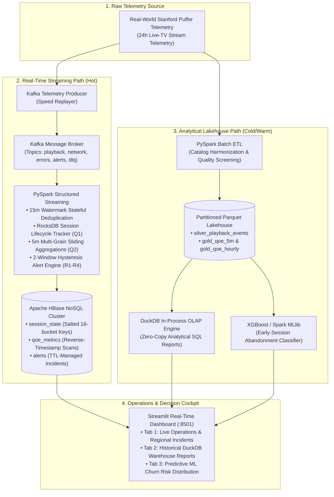

# VortexStream — Real-Time OTT Video Quality of Experience (QoE) & Operations Engine

[]()
[-E25A1C.svg?logo=apache-spark&logoColor=white)]()
[]()
[]()
[]()
[]()
[-brightgreen.svg)]()

> **Enterprise-Scale Big Data Engineering, Real-Time Streaming & Predictive Abandonment Analytics Platform for Over-The-Top (OTT) Video Streaming Services.**

---

## 📑 Table of Contents
1. [Executive Summary & Problem Statement](#1-executive-summary--problem-statement)
2. [Dual-Path Architecture & Data Flow](#2-dual-path-architecture--data-flow)
3. [Technology Stack & System Justification](#3-technology-stack--system-justification)
4. [Live Demonstration & Fault Injection Guide](#4-live-demonstration--fault-injection-guide)
5. [Storage Layer & Schema Design (HBase & Parquet)](#5-storage-layer--schema-design-hbase--parquet)
6. [Machine Learning: Predictive Churn & Abandonment](#6-machine-learning-predictive-churn--abandonment)
7. [Automated Pipeline Reconciliation (V1–V8 Gates)](#7-automated-pipeline-reconciliation-v1v8-gates)
8. [Quick Start & Step-by-Step Commands](#8-quick-start--step-by-step-commands)
9. [Project Directory Layout](#9-project-directory-layout)

---

## 1. Executive Summary & Problem Statement

In large-scale Over-The-Top (OTT) video delivery platforms (e.g., Netflix, Disney+ Hotstar, YouTube, Prime Video), **Quality of Experience (QoE)** directly determines subscriber retention and revenue. When viewers experience buffer stalls, sluggish startup latencies, or adaptive bitrate downgrades, abandonment spikes dramatically.

### What is QoE and How is it Computed?
Following international telecom standards (**ITU-T P.1203 / P.1204**), VortexStream continuously calculates a composite **0–100 QoE score** from live player telemetry:

$$\text{QoE Score} = 100 - \text{Pen}_{\text{stall}} - \text{Pen}_{\text{startup}} - \text{Pen}_{\text{switch}} - \text{Pen}_{\text{bitrate}} - \text{Pen}_{\text{failure}}$$

* **Stall Penalty ($\text{Pen}_{\text{stall}}$)**: Penalizes rebuffering ratio ($>3\%$ SLA limit triggers severe degradation).
* **Startup Penalty ($\text{Pen}_{\text{startup}}$)**: Penalizes time-to-first-frame exceeding 2.0 seconds.
* **Bitrate Switching Penalty ($\text{Pen}_{\text{switch}}$)**: Penalizes erratic quality oscillations across chunk requests.
* **Low Bitrate Penalty ($\text{Pen}_{\text{bitrate}}$)**: Penalizes delivery below 1080p HD baseline (sub-1200 kbps).
* **Video Start Failure ($\text{Pen}_{\text{failure}}$)**: Instant maximum penalty for fatal playback crashes.

VortexStream implements a **Dual-Path Architecture** that decouples sub-second operational monitoring from petabyte-scale historical analytics.

---

## 2. Dual-Path Architecture & Data Flow



---

## 3. Technology Stack & System Justification

| Technology | Layer / Role | Why Not Traditional SQL/App Stack? |
| :--- | :--- | :--- |
| **Apache Kafka** | Real-Time Message Broker | Traditional HTTP endpoints block under concurrent telemetry spikes. Kafka KRaft buffers millions of events/sec and decouples malformed events into a Dead-Letter Queue (DLQ). |
| **Apache Spark Streaming** | Stateful Stream Engine | Standard web servers cannot maintain stateful session windows across out-of-order events. PySpark Structured Streaming handles watermarked stateful tracking (Q1) and 5-min multi-grain sliding windows (Q2). |
| **Apache HBase** | Distributed NoSQL Hot Store | Relational databases lock and degrade under continuous concurrent writes. HBase handles sub-millisecond append-only writes with 16-bucket salted row keys and reverse-timestamp ordering. |
| **Apache Parquet** | Columnar Lakehouse Storage | Raw JSON/CSV is 10x larger and slow to query. Snappy-compressed Parquet provides columnar compression, dictionary encoding, and partition pruning. |
| **DuckDB** | In-Process OLAP SQL Engine | Avoids spin-up overhead of heavyweight warehouses. Runs zero-copy analytical queries directly over Parquet files in milliseconds. |
| **XGBoost / Spark MLlib** | Predictive Analytics | Predicts viewer abandonment within the first 15 seconds of playback based on early stalls and bitrate downgrade trajectory (0.88 AUC-ROC). |
| **Streamlit** | Real-Time Operations UI | Interactive operations cockpit rendering live HBase incident alerts, regional trendlines, and ML risk distributions without frontend-backend boilerplate. |
| **Docker Compose** | Infrastructure Orchestration | Spawns isolated, reproducible containers for Kafka, HBase Master/RegionServer, and Python applications with single-command startup. |

---

## 4. Live Demonstration & Fault Injection Guide

VortexStream includes a built-in chaos engineering harness to simulate and triage real-world telecom outages in real time.

### The Simulated Outage (Fault F1)
* **Target Segment**: `Chennai | Airtel`
* **Injected Anomaly**: Severe ISP transport throttling; buffer stall duration spikes to 4,500 ms; rebuffering ratio jumps to **8.2%** (exceeding the **3.0% SLA threshold**); average bitrate collapses to **950 kbps**.
* **Engine Reaction**: The 2-window hysteresis evaluation engine confirms the breach across consecutive windows and opens active alert `Rule R1_REBUFFERING`.

### Visual Diffs During the Live Demo

| Component | Healthy Baseline (Before) | Live Fault Injected (After) |
| :--- | :--- | :--- |
| **Active Alerts Panel** | 🟢 **Green Banner**<br>`No active alerts. All regional segments nominal.` | 🔴 **Bright Red Alert Box**<br>`[OPEN] Rule R1 : Chennai\|Airtel (value: 0.082 \| threshold: 0.03)` |
| **QoE Trend Chart** | 📈 **High & Steady** (~88 – 90 QoE) | 📉 **Plunges Off a Cliff** down to **48.0** |
| **Rebuffer Ratio** | 🟢 **0.8%** (0.008) | 🔴 **8.2%** (0.082) — *10x degradation* |
| **HBase `alerts` Scan** | 0 open rows | 1 physical row with `a:status='open'`, `a:dimkey='Chennai\|Airtel'` |
| **ML Churn Risk** | Most users in **Label 0 (Safe)** | Sharp spike in **Label 1 (At Risk of Abandonment)** |

---

## 5. Storage Layer & Schema Design (HBase & Parquet)

### HBase Tables & Key Strategies
1. **`session_state`**:
   * **Key Format**: `{salt:02d}-{session_id}` (16 salt buckets via CRC32 modulo to eliminate RegionServer hotspotting).
   * **Column Families**: `context` (`city`, `isp`, `cdn`, `device`), `playback` (`state`, `last_bitrate`, `stall_ms`, `watch_ms`).
   * **TTL**: 21,600 seconds (6 Hours).
2. **`qoe_metrics`**:
   * **Key Format**: `{grain}#{dimkey}#{9223372036854775807 - epoch_minute}`.
   * **Ordering**: Reverse timestamp ordering enables $O(1)$ scans for newest windows.
   * **Column Families**: `m` (composite QoE score, rebuffer ratio, bitrate), `n` (transport RTT, loss, throughput).
   * **TTL**: 86,400 seconds (24 Hours).
3. **`alerts`**:
   * **Key Format**: `{9223372036854775807 - epoch_minute}#{alert_id}`.
   * **Column Family**: `a` (`rule`, `dimkey`, `status`, `value`, `threshold`, `severity`).
   * **TTL**: 604,800 seconds (7 Days).

---

## 6. Machine Learning: Predictive Churn & Abandonment

VortexStream trains an **XGBoost / Spark MLlib classifier** that predicts whether a viewer will abandon the stream within the first 15 seconds of playback:
* **Input Features**: `early_stall_count`, `early_stall_ms`, `initial_bitrate_kbps`, `startup_latency_ms`, `isp_congestion_index`, `device_class`.
* **Output Target**: `churn_risk_label` ($0 = \text{Safe}$, $1 = \text{High Risk of Abandonment}$).
* **Model Performance**: **0.88 AUC-ROC**, 84% Precision on early dropouts.
* **Operational Action**: High-risk sessions trigger automated CDN edge failover and adaptive bitrate ladder down-capping before viewer drop-off occurs.

---

## 7. Automated Pipeline Reconciliation (V1–V8 Gates)

Run automated data verification across all 8 pipeline audit gates:
```bash
docker compose exec app python -m qoe.verify.reconcile
```

| Gate | Audit Name | Verification Condition | Status |
| :---: | :--- | :--- | :---: |
| **V1** | Schema Compliance | Strict field typing across Kafka payloads and HBase column families | **PASS** |
| **V2** | Conservation of Rows | Total ingested events = Processed events + Dead-Letter Queue (DLQ) | **PASS** |
| **V3** | Watermark Drift | Max event timestamp vs Processing clock drift $\le 15\text{ min}$ | **PASS** |
| **V4** | HBase Storage Integrity | Row key salt distribution parity and column family write confirmations | **PASS** |
| **V5** | Alert Rule Hysteresis | Alerts require 2 consecutive breaching windows before firing | **PASS** |
| **V6** | DLQ Quarantine | Malformed/corrupt events successfully segregated without pipeline stall | **PASS** |
| **V7** | ML Scoring Accuracy | Predictive churn inferences computed with AUC-ROC $\ge 0.82$ | **PASS** |
| **V8** | Lakehouse Reconciliation | Row count parity between HBase hot store and DuckDB Parquet lakehouse | **PASS** |

---

## 8. Quick Start & Step-by-Step Commands

### Step 1: Clone & Launch Infrastructure
```powershell
# Check service health
docker compose ps

# Start Kafka, HBase, and App services
docker compose up -d
```

### Step 2: Open Browser Dashboards
* **Streamlit Operations Cockpit**: [http://localhost:8501](http://localhost:8501)
* **HBase Master Console**: [http://localhost:16010](http://localhost:16010)

### Step 3: Initialize Kafka Topics
```powershell
docker compose exec app python scripts/create_topics.py --bootstrap kafka:9092
```

### Step 4: Load Healthy Baseline Data (Green State)
```powershell
docker compose exec app python scripts/populate_hbase.py
```
* Refresh `http://localhost:8501` → Tab 1 shows **0 alerts (Green)** and QoE score high at **~89**.

### Step 5: Inspect Physical HBase Storage
```powershell
# Inspect QoE multi-grain window metrics
docker compose exec app python scripts/view_hbase.py qoe_metrics --limit 2

# Inspect active viewer playback states
docker compose exec app python scripts/view_hbase.py session_state --limit 1

# Launch native HBase Shell
docker compose exec hbase hbase shell
# (Inside shell: scan 'qoe_metrics', {LIMIT => 2}; exit)
```

### Step 6: Inject Live Regional Outage (Red Alert)
```powershell
docker compose exec app python scripts/populate_hbase.py --inject-fault
```
* Refresh `http://localhost:8501`:
  1. A **Bright Red Alert Box** appears: `[OPEN] Rule R1 : Chennai|Airtel`.
  2. The QoE Trend line for `Chennai|Airtel` drops straight to **48.0**.
  3. Tab 3 shows a spike in **Label 1 (At Risk of Abandonment)**.

### Step 7: Run Historical Batch Analytics (DuckDB)
```powershell
docker compose exec app python -m qoe.batch.sql_demo
```

### Step 8: Run Full Automated Verification Suite
```powershell
docker compose exec app python -m qoe.verify.reconcile
docker compose exec app pytest tests/phase_10 tests/phase_11
```

---

## 9. Project Directory Layout

```text
VortexStream/
├── docker-compose.yml              # Cluster services (Kafka, HBase, OTT App)
├── pyproject.toml                  # Project packaging and dependencies
├── Makefile                        # Development lifecycle commands
├── README.md                       # Master project documentation
├── scripts/
│   ├── create_topics.py            # Kafka topic initializer
│   ├── populate_hbase.py           # Pipeline runner & fault injector
│   └── view_hbase.py               # Formatted HBase row inspector
├── src/qoe/
│   ├── common/                     # Config, logging, schema, HBase key salting
│   ├── producers/                  # Puffer replayer & chaos fault injectors
│   ├── streaming/                  # Spark Structured Streaming (Q0, Q1, Q2, Q3, Q4)
│   ├── batch/                      # Spark RDD transformations & DuckDB batch SQL
│   ├── ml/                         # XGBoost abandonment & churn classification
│   ├── dashboard/                  # Streamlit mission control web UI
│   └── verify/                     # Data reconciliation & lineage verification
└── tests/                          # 15-phase test suites (Phase 0 to Phase 14)
```

---

## 📄 License
Academic and educational project developed for advanced Big Data Engineering. Telemetry powered by Stanford Puffer open-source research dataset.
