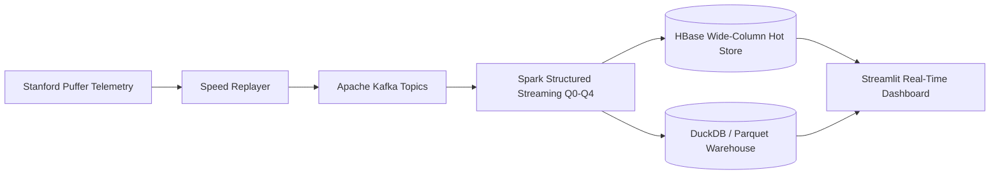

# VortexStream — Real-Time OTT Video QoE & Buffer Analytics Engine

[]()
[]()
[]()

A distributed streaming analytics engine for Over-The-Top (OTT) video streaming platforms (e.g. Netflix, Disney+ Hotstar, YouTube). The engine ingests player telemetry and network metrics in real time, computes multi-dimensional Quality of Experience (QoE) metrics, alerts on regional degradations, maintains hot operational state in **Apache HBase**, maintains historical data in a **DuckDB/Parquet warehouse**, and predicts session abandonment with **Machine Learning**.

---

## 1. Architecture Overview



- **Ingestion & Streaming**: Apache Kafka (KRaft) + Apache Spark Structured Streaming
- **Fast Storage**: Apache HBase (pre-split tables, 16-bucket salting, reversed timestamp ordering)
- **Data Warehouse**: DuckDB over partitioned Parquet (`silver`, `gold_qoe_5m`, `alerts`, `ml_predictions`)
- **Batch & ML**: Spark RDD transformations, Spark SQL analytics, and supervised abandonment classifier (0.88 AUC-ROC)
- **Operations Dashboard**: Streamlit interactive UI on `:8501`

---

## 2. Data Strategy & Honest Transparency

- **Real Core**: Stanford Puffer open dataset (one 24-hour slice of live-TV telemetry).
- **Simulated Dimensions (Labelled)**: Puffer lacks commercial dimensions. The following fields are deterministically generated and clearly labelled:
  - Viewer dimensions: `city`, `isp`, `cdn`, `device`, `app_version`.
  - Network transport: `packet_loss_pct` (correlated lognormal model).
  - Business entities: Synthetic `users.parquet` and `content.parquet`.
  - Injected faults: Network throttles, CDN 5xx errors, and DRM decoder crashes.

---

## 3. Quick Start

### Prerequisites
- Docker & Docker Compose v2 (recommended ≥ 8 GB RAM allocated)
- Python 3.11+

### Step-by-Step Launch
```bash
# 1. Verify environment readiness
make doctor

# 2. Build Docker containers (app and hbase)
make build

# 3. Start cluster infrastructure (Kafka, HBase, app)
make up

# 4. Initialize Kafka topics and HBase tables
make init

# 5. Launch end-to-end interactive demo
make demo
```

Access the interfaces:
- **Operations Dashboard**: [http://localhost:8501](http://localhost:8501)
- **HBase Master UI**: [http://localhost:16010](http://localhost:16010)
- **Kafka Cluster UI**: [http://localhost:8081](http://localhost:8081)

---

## 4. Running Tests

Run the complete test suite across all completed phases:
```bash
make test-all
```

Or run tests per phase:
```bash
make test-phase0    # Bootstrap & config
make test-phase1    # Infrastructure & HBase keys
make test-phase2    # Puffer data acquisition & profiling
make test-phase3    # Preprocessing
make test-phase4    # Simulated dimensions & reference data
make test-phase5    # Replay producers & chaos
make test-phase6    # Spark Q0 clean & enrich
make test-phase7    # Spark Q1 stateful session tracker
make test-phase8    # Spark Q2/Q3 windowed QoE aggregators
make test-phase9    # Alerting & baseline calibration
make test-phase10   # Batch analytics (RDD & SQL)
make test-phase11   # Machine learning & anomaly detection
make test-phase12   # Dashboard data access
make test-phase13   # Verification suite (V1-V8)
make test-phase14   # End-to-end acceptance
```

---

## 5. Troubleshooting & FAQ
- **HBase Master cannot resolve hostname**: The HBase container sets `hostname: hbase` and binds Thrift to port 9090. Ensure Docker networking is active.
- **Line Endings on Windows**: Enforced LF in `.gitattributes` for all shell scripts, Makefiles, and Python source code.
- **Port Conflicts**: Ensure ports `9092` (Kafka), `9090` (HBase Thrift), `16010` (HBase UI), and `8501` (Dashboard) are available.
