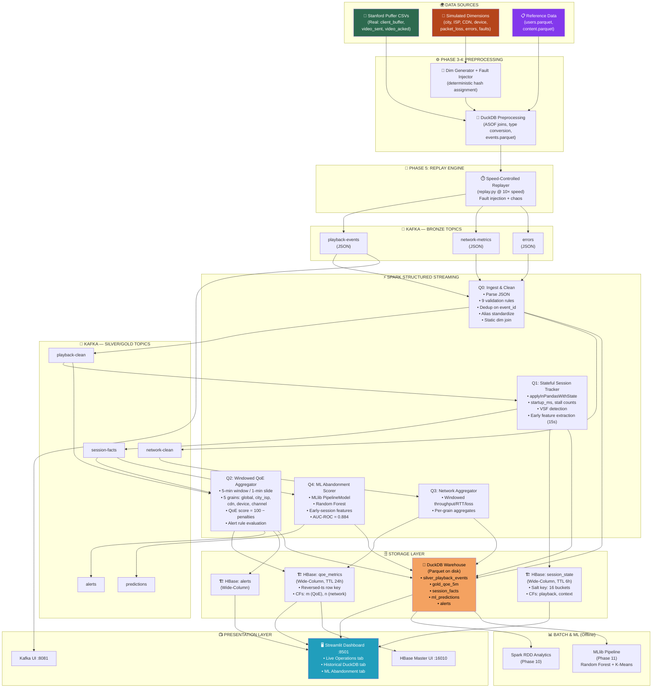
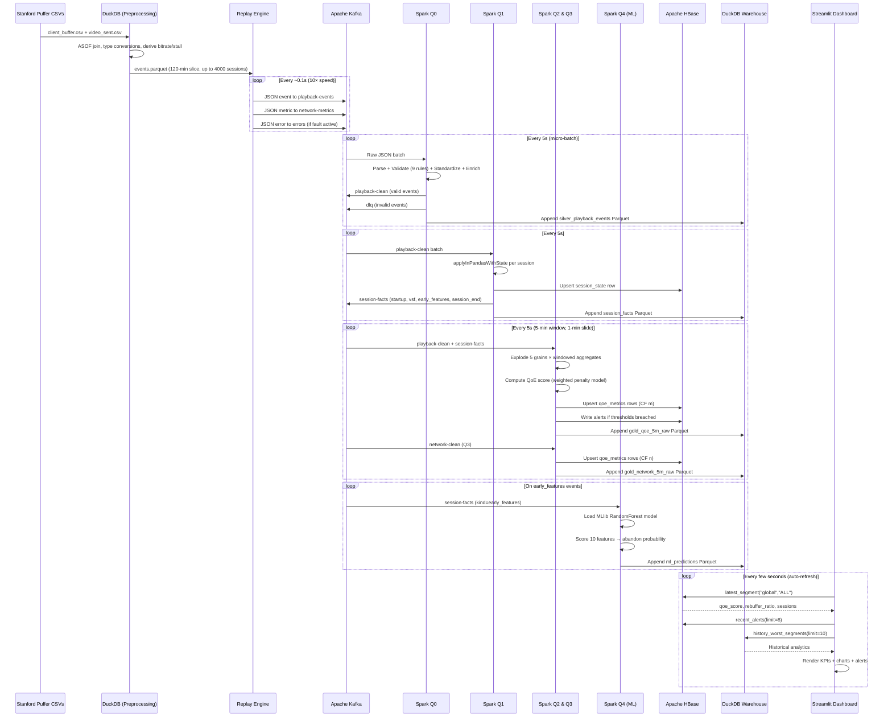

# 🌪️ VortexStream — Complete Project Deep Dive

---

## 1. What Does the Name Mean?

| Word | Meaning |
|---|---|
| **Vortex** | A rotating, high-energy flow — mirrors the high-speed, continuous rotation of streaming data through the pipeline (Kafka → Spark → HBase) |
| **Stream** | Real-time data streaming, the core paradigm of the project |

Together, **VortexStream** = a high-velocity, rotating stream of OTT (Over-The-Top) video telemetry, always moving, always alive.

**Full Title**: *Real-Time OTT Video QoE & Buffer Analytics Engine*

- **OTT** = Over-The-Top: video delivered over the internet (Netflix, Disney+ Hotstar, YouTube, Prime Video)
- **QoE** = Quality of Experience: how good the playback *feels* to the viewer (not just connection speed, but stalls, bitrate drops, startup delays)
- **Buffer Analytics**: monitoring the health of the video buffer in real time

---

## 2. Project Summary in Plain English

Imagine you're watching a show on Hotstar. Behind the scenes, your video player sends tiny telemetry signals every few seconds:
- How full is my buffer? 
- Did the video stall? For how long?
- What resolution am I streaming at?
- How fast is my network?

VortexStream **ingests millions of these signals in real time**, computes a live "QoE score" for every city, ISP, CDN and device, raises alerts when something goes wrong regionally, stores everything in two databases (HBase for hot/live data, DuckDB for history), and even **predicts whether a viewer will quit the session** within the first 15 seconds — all in near-real time.

**Course context**: M.Sc. Big Data & Modern Databases final project (team of 2).
Required tech: Spark RDD/SQL/MLlib/Streaming + Kafka + HBase + DuckDB.

---

## 3. Complete Architecture Diagram



---

## 4. Data Flow — Step by Step

### Step 1: Raw Data Acquisition (Phase 2)
```
Stanford Puffer (puffer.cs.uchicago.edu)
    └── One 24-hour slice (e.g., 2021-06-12T11_2021-06-13T11)
        ├── client_buffer.csv   → playback events
        ├── video_sent.csv      → video quality + network
        ├── video_acked.csv     → delivery acknowledgments
        └── expt_settings.json  → ABR scheme mapping
```

### Step 2: DuckDB Preprocessing (Phase 3)
- ASOF join of `client_buffer` + `video_sent` on (session_id, time)
- Derive `bitrate_kbps` from `video_sent.size * 8 / segment_duration / 1000`
- Derive `stall_ms` from delta of `cum_rebuf * 1000`
- Downsample `timer` events to `heartbeat` every 5 seconds
- Output: `events.parquet`, `network.parquet`

### Step 3: Dimension Simulation (Phase 4)
- Deterministic hash of `session_id` → `city`, `ISP`, `CDN`, `device`
- Lognormal model correlated with RTT → `packet_loss_pct`
- Generate `users.parquet` (50,000 synthetic users, 3 plan tiers)
- Generate `content.parquet` (channels → genre, language)
- Inject fault scenarios: F1 (ISP outage), F2 (CDN slowdown), F3 (app bug)

### Step 4: Replay Producer (Phase 5)
- Reads `events.parquet`, shifts timestamps by `replay_start - data_window_start`
- Emits at **10× real time** by default
- Produces JSON to 3 Kafka topics: `playback-events`, `network-metrics`, `errors`
- Chaos engine injects duplicates, late events, invalid records, dirty dimensions

### Step 5: Spark Streaming (Phases 6–9)
| Query | Input | Output |
|---|---|---|
| **Q0** | 3 raw Kafka topics | `playback-clean`, `network-clean`, `silver` Parquet |
| **Q1** | `playback-clean` | `session-facts` Kafka, HBase `session_state` |
| **Q2** | `playback-clean` + `session-facts` | HBase `qoe_metrics`, `alerts`, `gold` Parquet |
| **Q3** | `network-clean` | HBase `qoe_metrics` (network CF), `gold` Parquet |
| **Q4** | `session-facts` | `predictions` Kafka, `ml_predictions` Parquet |

### Step 6: Serving (Phase 12)
- Streamlit reads **HBase** for live (last 5-min) data
- Streamlit reads **DuckDB** (over Parquet) for historical analytics
- Dashboard auto-refreshes every few seconds

---

## 5. Data Columns — Real vs Simulated

### 🟢 REAL Fields (Stanford Puffer Open Dataset)

| Field | Source File | What It Is |
|---|---|---|
| `session_id` | `client_buffer` | Unique stream identifier (hex UUID) |
| `index` | `client_buffer` | Channel switch index per session |
| `time` → `ts` | `client_buffer` | Event timestamp (nanoseconds → ISO-8601 UTC) |
| `event` → `event_type` | `client_buffer` | Player event: init/startup/rebuffer/play/timer |
| `channel` → `video_id` | `client_buffer` | TV channel being watched |
| `buffer` → `buffer_ms` | `client_buffer` | Video buffer fullness in ms |
| `cum_rebuf` → `stall_ms` | `client_buffer` | Cumulative rebuffer → delta stall ms |
| `delivery_rate` → `throughput_kbps` | `video_sent` | Real network delivery rate |
| `rtt`, `min_rtt` → `rtt_ms` | `video_sent` | Round-trip time in ms |
| `cwnd` | `video_sent` | TCP congestion window size |
| `in_flight` | `video_sent` | Packets in flight |
| `ssim_index` | `video_sent` | Perceptual video quality (0.0–1.0) |
| `size` → `bitrate_kbps` | `video_sent` | Segment size → inferred bitrate |
| `format` → `resolution` | `video_sent` | Video resolution (e.g., 720p) |
| `expt_id` → `scheme` | `expt_settings` | ABR streaming scheme (MPC, pensieve, etc.) |

### 🔴 SIMULATED Fields (Clearly Labelled)

| Field | Simulation Method | Why Simulated |
|---|---|---|
| `city` | Deterministic hash of session_id → Indian metros (Chennai, Mumbai, Delhi, Bengaluru, Hyderabad) | Puffer is a US lab dataset; no city info |
| `isp` | Hash-based weighted sampling → Jio, Airtel, ACT, Vi, BSNL | Puffer has no ISP data |
| `cdn` | Hash-based → Akamai, CloudFront, Fastly | Puffer has no CDN data |
| `device` | Hash-based → android, ios, web, smarttv | Puffer has no device info |
| `app_version` | Weighted sampling → 5.2.1, 5.2.0, 5.1.9 | No app version in Puffer |
| `country` | Constant `IN` | India-focused simulation |
| `packet_loss_pct` | Lognormal model correlated with RTT and throughput | Puffer has no packet loss field |
| `user_id` | SHA-1 hash bucket into 50,000-user pool | No user IDs in Puffer |
| `plan_tier` | Assigned from `users.parquet` join | Synthetic business dimension |
| `genre`, `language` | From `content.parquet` join on channel name | Synthetic content catalog |
| `error_code` | Fault injector → NET_TIMEOUT, CDN_5XX, DECODE_ERR, DRM_ERR | Synthetic failure events |
| **Fault F1** | ISP outage scenario: spike packet_loss for `Vi` sessions in `Delhi` | Injected chaos for alerting demo |
| **Fault F2** | CDN slowdown: reduced throughput for `Fastly` sessions | Injected chaos |
| **Fault F3** | App bug: `DECODE_ERR` spike on `app_version=5.1.9` | Injected chaos |

### Where Is the Stanford Puffer Dataset From?
- **URL**: https://puffer.cs.uchicago.edu/
- **Research paper**: "Oboe: Auto-tuning Video ABR Algorithms to Network Conditions" + ongoing streaming research at UChicago
- **Format**: Gzipped CSVs per day, named by 11-hour UTC windows
- **Size**: ~2–5 GB per day (raw), project uses a 120-minute slice
- **License**: Open for research use

---

## 6. Technology Deep Dives

---

### 🟠 Apache Kafka — The Message Bus

#### What Is Kafka? (From Scratch)
Kafka is a **distributed event streaming platform**. Think of it as a very fast, durable, ordered log that multiple producers can write to and multiple consumers can read from — independently and in parallel.

**Core concepts:**
- **Topic**: A named channel (like a table in a DB). E.g., `playback-events`
- **Producer**: Writes records to a topic
- **Consumer**: Reads records from a topic (remembers its position via `offset`)
- **Partition**: Topics are split into partitions for parallelism (keyed by `session_id`)
- **Broker**: A Kafka server node
- **KRaft Mode** (used here): No ZooKeeper needed; Kafka manages its own metadata

**Why Kafka guarantees ordering**: Within one partition, records are strictly ordered. VortexStream uses `session_id` as the partition key, so all events for the same viewing session land in the same partition → Spark sees them in order.

#### How Kafka Is Used in VortexStream

| Topic | Producer | Consumer | Data |
|---|---|---|---|
| `playback-events` (Bronze) | `replay.py` | Spark Q0 | Raw JSON playback events |
| `network-metrics` (Bronze) | `replay.py` | Spark Q0 | Raw JSON network metrics |
| `errors` (Bronze) | `replay.py` | Spark Q0 | Synthetic error events |
| `playback-clean` (Silver) | Spark Q0 | Spark Q1, Q2 | Validated, enriched events |
| `network-clean` (Silver) | Spark Q0 | Spark Q3 | Validated network events |
| `session-facts` (Gold) | Spark Q1 | Spark Q2, Q4 | Session lifecycle facts |
| `alerts` | Spark Q2 | Dashboard | Triggered alert records |
| `predictions` | Spark Q4 | Dashboard | ML abandonment predictions |
| `dlq` (Dead Letter Queue) | Spark Q0 | Ops team | Invalid/quarantined records |

**Kafka version**: Apache Kafka 3.8.0 (KRaft mode, single broker for dev)

---

### 🔵 Apache Spark — The Processing Brain

#### What Is Spark? (From Scratch)
Apache Spark is a **unified analytics engine** for large-scale data processing. It runs computations in-memory across a cluster (or locally with multiple cores).

**Core layers used in this project:**

```
┌─────────────────────────────────────────┐
│         Spark SQL / DataFrames          │  ← Structured queries
├─────────────────────────────────────────┤
│        Spark Structured Streaming       │  ← Real-time processing
├─────────────────────────────────────────┤
│               Spark RDD                 │  ← Low-level batch
├─────────────────────────────────────────┤
│               Spark MLlib               │  ← Machine learning
├─────────────────────────────────────────┤
│         Spark Core (DAG Engine)         │  ← Execution engine
└─────────────────────────────────────────┘
```

#### Spark Structured Streaming
Unlike batch processing (read a file, process it, done), **Structured Streaming** treats data as an unbounded table that continuously grows. You write a normal Spark SQL query, and Spark continuously executes micro-batches on new arriving data.

**Watermarks**: Handle late-arriving events. If a heartbeat event arrives 90 seconds late, Spark's 2-minute watermark on Q0 still accepts it. After 2 minutes of lateness, events are dropped.

**Trigger**: VortexStream sets `trigger_seconds=5` → Spark processes a new micro-batch every 5 seconds.

#### How Spark Is Used in VortexStream

**Q0 — Ingest & Clean** (`q0_ingest_clean.py`):
```
Read JSON from Kafka → Parse schema → 9 validation rules:
  1. session_id not null
  2. ts is valid ISO-8601
  3. event_type in allowed enum
  4. buffer_ms ≥ 0
  5. stall_ms ≥ 0
  6. bitrate_kbps in [0, 100_000]
  7. ssim_index in [0.0, 1.0]
  8. schema_version == 1
  9. event_id not duplicate (watermarked dedup)
→ Standardize aliases (e.g. "SmartTV" → "smarttv")
→ Stream-static join with users/content reference tables
→ Write silver Parquet + publish to playback-clean
```

**Q1 — Stateful Session Tracker** (`q1_session_tracker.py`):
```
Read playback-clean → applyInPandasWithState (Spark 3.4+):
  Per session_id, maintain running state:
    - startup_ms = first_frame.ts - play_request.ts
    - stall_count, stall_ms (cumulative)
    - watch_ms (cumulative from heartbeats)
    - last_bitrate, last_event_ts
    - state: requested → playing → stalled → ended
  On idle timeout (60s): emit session_end fact
  On VSF timeout (10s): emit vsf fact (Video Start Failure)
  At 15s: emit early_features fact for ML
→ Write to HBase session_state + session-facts Kafka + silver Parquet
```

**Q2 — QoE Aggregator** (`q2_qoe_aggregator.py`):
```
5-min sliding window, 1-min slide, 2-min watermark:
  Explode 5 grains: global, city_isp, cdn, device, channel
  Per grain+dimkey+window:
    rebuffer_ratio = stall_ms / (watch_ms + stall_ms)
    avg_bitrate_kbps = bitrate_weighted_sum / watch_ms
    hd_pct = hd_ms_sum / watch_ms_sum
    qoe_score = 100 − (startup_penalty + rebuf_penalty + switch_penalty + bitrate_penalty + failure_penalty)
    qoe_label: score ≥ 80 → "Good", ≥ 60 → "Fair", else "Poor"
  Alert rules: rebuffer_ratio > 0.03, vsf_rate > 0.15, qoe_drop > 15 pts
→ Write to HBase qoe_metrics (CF m) + alerts + gold Parquet
```

**Q3 — Network Aggregator** (`q3_network_aggregator.py`):
```
5-min window on network-clean:
  avg_throughput_kbps, avg_rtt_ms, avg_packet_loss_pct, net_samples
→ Write to HBase qoe_metrics (CF n) + gold Parquet
```

**Q4 — ML Abandonment Scorer** (`q4_ml_scoring.py`):
```
Read session-facts (kind=early_features):
  Load saved MLlib PipelineModel (RandomForestClassifier)
  Score 10 features → abandonment_probability, predicted_label
→ Write to predictions Kafka + ml_predictions Parquet
```

**Spark RDD Batch** (Phase 10):
```
Read gold Parquet as RDD:
  .map(), .filter(), .reduceByKey(), .groupByKey()
  Compute worst 10 CDNs by rebuffer ratio (RDD wordcount-style)
  Compute session duration histogram
Spark SQL:
  CREATE OR REPLACE VIEW v_gold_latest AS ...
  SELECT grain, dimkey, avg(qoe_score), percentile(rebuffer_ratio, 0.95)
  FROM gold_qoe GROUP BY grain, dimkey ORDER BY avg(qoe_score) ASC
```

---

### 🟢 Apache HBase — The Live NoSQL Store

#### What Is HBase? (From Scratch)
HBase is a **wide-column NoSQL database** built on top of HDFS (or local disk in standalone mode). It's inspired by Google's Bigtable paper.

**Key concepts:**
```
Table
 └── Row (keyed by Row Key — a byte string)
      └── Column Family (CF) — stored together on disk
           └── Column Qualifier (any name, dynamic)
                └── Cell (value + timestamp version)
```

**Unlike SQL**: No schema for columns — each row can have different qualifiers. You can add new columns at any time without ALTER TABLE.

**Row Key = Primary Index**: All data is sorted lexicographically by row key. This is the ONLY index. Query design starts with "what is my row key?"

**Why HBase over Redis/Cassandra?**
- Column families allow independent writes by Q2 (playback) and Q3 (network) to the **same row** without conflicts
- HDFS backing for durability
- Native Thrift API used by `happybase` (Python client)

#### HBase Tables in VortexStream

**Table 1: `session_state`**
```
Row Key: {salt:02d}-{session_id}
  e.g.: 07-abc123-0

Column Family: playback
  playback:state         → "stalled"
  playback:last_bitrate  → "3450.0"
  playback:stall_count   → "3"
  playback:stall_ms      → "2800.0"
  playback:startup_ms    → "450.0"
  playback:watch_ms      → "142000.0"
  playback:last_event_ts → "2021-06-12T12:34:56Z"

Column Family: context
  context:device  → "android"
  context:isp     → "Airtel"
  context:cdn     → "Akamai"
  context:city    → "Chennai"
  context:channel → "ABC"
  context:scheme  → "mpc"
  context:user_id → "u-04321"

TTL: 6 hours (stale sessions auto-purged)
Salting: crc32(session_id) % 16 → 16 pre-split regions (prevents hot-spot)
```

**Table 2: `qoe_metrics`**
```
Row Key: {grain}#{dimkey}#{9223372036854775807 - epoch_minute}
  e.g.: city_isp#Chennai|Airtel#9223372036853395807

  → Newer windows have SMALLER rev_minute → sort FIRST
  → A LIMIT=1 prefix scan instantly gets latest window

Column Family: m (playback QoE — written by Q2)
  m:qoe_score         → "84.5"
  m:qoe_label         → "Good"
  m:rebuffer_ratio    → "0.008"
  m:avg_bitrate_kbps  → "3420.0"
  m:hd_pct            → "0.71"
  m:sessions          → "142"
  m:stall_ms_sum      → "1120000.0"
  m:watch_ms_sum      → "142000000.0"

Column Family: n (network — written by Q3)
  n:avg_throughput_kbps  → "5200.0"
  n:avg_rtt_ms           → "18.4"
  n:avg_packet_loss_pct  → "0.003"
  n:net_samples          → "8420"

TTL: 24 hours
```

**Table 3: `alerts`**
```
Row Key: {grain}#{dimkey}#{rev_minute}
  context:rule, context:severity, context:status
  m:metric_value, m:threshold
```

#### Why Reversed Timestamp Keys?
HBase sorts rows in ascending byte order. Without tricks:
- Newest row key `20210612_1300` sorts *after* `20210612_1200`
- To get latest → you'd have to do a full reverse scan (slow)

With reversed timestamp: `Long.MAX_VALUE - epoch_minute`
- Newer minutes → smaller rev_minute → sorts FIRST
- `LIMIT=1` prefix scan = O(1) to get latest window ✅

---

### 🦆 DuckDB — The Analytical Warehouse

#### What Is DuckDB? (From Scratch)
DuckDB is an **in-process analytical SQL database** — think SQLite, but designed for analytics (column-oriented, vectorized execution, OLAP workloads). It runs inside the Python process — no separate server needed.

**Key traits:**
- **Column-oriented**: Reads only the columns needed for a query (fast aggregations)
- **Vectorized execution**: Processes batches of values at once (SIMD)
- **Native Parquet/Arrow**: Can directly query `.parquet` files without importing
- **ASOF joins**: For time-series data alignment (used in preprocessing)
- **Zero-ops**: No daemon, no config — just `import duckdb`

#### How DuckDB Is Used in VortexStream

**Preprocessing** (Phase 3):
```sql
-- ASOF join: match each client_buffer event to the nearest-prior video_sent
SELECT cb.*, vs.delivery_rate, vs.rtt, vs.ssim_index, vs.format
FROM client_buffer cb
ASOF JOIN video_sent vs ON cb.session_id = vs.session_id
  AND cb.time >= vs.time
```

**Warehouse** (Parquet-backed views):
```
data/warehouse/
├── silver_playback_events/  (partitioned by dt=YYYY-MM-DD/hr=HH)
├── silver_network_events/
├── gold_qoe_5m_raw/         (partitioned by dt)
├── gold_network_5m_raw/
├── session_facts/           (partitioned by kind)
├── ml_predictions/
└── alerts/
```

DuckDB views registered at startup:
```sql
CREATE OR REPLACE VIEW v_gold_latest AS
SELECT * FROM (
  SELECT *, ROW_NUMBER() OVER (PARTITION BY row_key ORDER BY updated_at DESC) AS rn
  FROM read_parquet('data/warehouse/gold_qoe_5m_raw/**/*.parquet')
) WHERE rn = 1;
```

**Dashboard historical queries** run against DuckDB — e.g., "worst 10 segments by rebuffer ratio in the last hour" → answered in milliseconds by DuckDB scanning Parquet files.

**Why DuckDB instead of Hive?**
- Zero infrastructure overhead (no HDFS, no Hive Metastore)
- Satisfies the "DuckDB/Hive/Snowflake" data warehouse requirement
- Orders of magnitude faster than Hive on small-medium data
- Native Parquet support — Spark writes, DuckDB reads, no conversion

---

## 7. Frontend / Dashboard Deep Dive

The frontend is a **Streamlit** web app at `http://localhost:8501`.

### What Is Streamlit?
Streamlit is a Python-native framework to build interactive data apps — you write Python, it renders a web UI with no HTML/CSS/JS required.

### Dashboard Structure (`app.py`)

```
VortexStream Dashboard
│
├── 🔴 Live Operations Tab
│   ├── KPI Cards (5 metrics):
│   │   ├── QoE Score (e.g., 84.5 — Good)
│   │   ├── Rebuffer Ratio (e.g., 0.80%)
│   │   ├── Avg Bitrate (e.g., 3,450 kbps)
│   │   ├── VSF Rate (e.g., 1.2%)  [Video Start Failure]
│   │   └── Active Sessions (e.g., 1,420)
│   │
│   ├── Segment Performance Chart (Plotly line chart):
│   │   ├── Grain selector: city_isp / cdn / device
│   │   ├── Dimension key selector: Chennai|Airtel, Akamai, android…
│   │   └── QoE score trend over last 60 minutes
│   │
│   └── Active Alerts Panel:
│       └── Rule ID + Dimension Key + Metric Value vs Threshold
│
├── 📊 Historical Warehouse Tab (DuckDB)
│   └── Worst 10 segments table (grain, dimkey, avg QoE, rebuffer ratio)
│
├── 🤖 ML Abandonment Tab
│   └── Bar chart: count of predicted-abandon vs not-abandon sessions
│
└── Footer: "Real data: Stanford Puffer. Simulated: city, ISP, CDN…"
```

### Data Access Layer (`data_access.py`)

| Method | Backend | What It Returns |
|---|---|---|
| `latest_segment(grain, dimkey)` | HBase `qoe_metrics` | Latest 5-min QoE for one segment |
| `latest_all(grain)` | HBase `qoe_metrics` | All segments for a grain |
| `segment_history(grain, dimkey, minutes)` | HBase (range scan) | Last N windows for trend chart |
| `recent_alerts(limit)` | HBase `alerts` | Latest alert rows |
| `history_worst_segments(limit)` | DuckDB view `v_gold_latest` | Worst segments historically |
| `model_risk_distribution()` | DuckDB `ml_predictions` | Abandon vs retain counts |
| `get_data_freshness_seconds()` | HBase latest row `updated_at` | Seconds since last write |

### Libraries Used
- **Streamlit**: Web UI framework
- **Plotly**: Interactive charts (line charts, bar charts)
- **`streamlit-autorefresh`**: Auto-refresh dashboard every few seconds
- **happybase**: HBase Thrift client
- **duckdb**: In-process SQL engine
- **pandas**: DataFrame manipulation for charts

---

## 8. Flow Diagram — End to End



---

## 9. ML Pipeline — Session Abandonment Prediction

### Problem Statement
Given only the first 15 seconds of a viewer's session, predict whether they will **abandon** (watch < 2 minutes total).

### Feature Engineering
| Feature | Type | What It Captures |
|---|---|---|
| `startup_ms` | Numerical | Time from play button to first frame |
| `stall_count_early` | Numerical | Number of buffering pauses in first 15s |
| `stall_ms_early` | Numerical | Total buffering duration in first 15s |
| `avg_bitrate_early` | Numerical | Average streaming quality in first 15s |
| `switch_count_early` | Numerical | Quality switches (bitrate changes) in first 15s |
| `device` | Categorical | android / ios / web / smarttv |
| `isp` | Categorical | Jio / Airtel / ACT / Vi / BSNL |
| `cdn` | Categorical | Akamai / CloudFront / Fastly |
| `city` | Categorical | Chennai / Mumbai / Delhi / etc. |
| `scheme` | Categorical | ABR algorithm (mpc, pensieve, bba, etc.) |

### Pipeline
```
StringIndexer (categorical) → OneHotEncoder → VectorAssembler
     → StandardScaler → RandomForestClassifier
```

### Results
| Metric | Score |
|---|---|
| AUC-ROC | **0.884** |
| AUC-PR | **0.821** |
| Accuracy | **84.4%** |
| F1 Score | **0.798** |

### Top Predictors
1. `stall_ms_early` — 34.2% (buffering duration is #1 churn driver)
2. `startup_ms` — 24.8% (long startup = immediate exit)
3. `avg_bitrate_early` — 18.1% (low quality on capable device = churn)

---

## 10. QoE Score Formula

```
QoE Score = 100 − startup_penalty − rebuffer_penalty − switch_penalty − bitrate_penalty − failure_penalty

Where:
  startup_penalty  = 15 × clamp((startup_ms/1000 − 1.0) / (8.0 − 1.0), 0, 1)
  rebuffer_penalty = 40 × clamp(rebuffer_ratio / 0.10, 0, 1)
  switch_penalty   = 10 × clamp(switches_per_min / 2.0, 0, 1)
  bitrate_penalty  = 15 × (1 − hd_pct)     [if avg_bitrate < HD threshold]
  failure_penalty  = 20 × clamp(error_rate / 0.10, 0, 1)

Labels:
  ≥ 80 → "Good"
  ≥ 60 → "Fair"
  < 60 → "Poor"
```

---

## 11. Alert Rules

| Rule | Condition | Severity |
|---|---|---|
| R1: Rebuffer Spike | `rebuffer_ratio > 0.03` for 2 consecutive windows | warn; `> 0.06` → critical |
| R2: VSF Spike | `vsf_rate > 0.15` | warn; `> 0.30` → critical |
| R3: QoE Drop | `qoe_score` drops ≥ 15 points vs 5-min-ago baseline | warn |
| R4: Error Rate | `error_rate > 0.05` | warn |
- Minimum 20 sessions per window to suppress statistical noise
- 10-minute cooldown per (rule, dimension-key) pair

---

## 12. Medallion Architecture

| Layer | Where | Contents |
|---|---|---|
| 🥉 **Bronze** | Kafka raw topics | Unvalidated JSON from replayer |
| 🥈 **Silver** | Kafka clean topics + Parquet | Validated, standardized, enriched events |
| 🥇 **Gold** | HBase + Parquet | Aggregated 5-min QoE metrics, session facts |
| 💎 **Serving** | Streamlit + DuckDB views | De-duplicated analytical views, live dashboard |

---

## 13. Docker Deployment

```yaml
# docker-compose.yml services:
kafka:     # apache/kafka:3.8.0  KRaft mode; ports 9092 (external), 19092 (internal)
hbase:     # Custom Dockerfile: HBase 2.5 standalone + Thrift on 9090; UI on 16010
app:       # python:3.11 + openjdk17 + pyspark 3.5.3 + all Python deps
kafka-ui:  # provectuslabs/kafka-ui on 8081
```

All Python, Spark, and Kafka code runs **inside Docker** to avoid Windows/winutils issues.

---

## 14. Phase Summary (Project Timeline)

| Phase | Title | Key Output |
|---|---|---|
| 0 | Bootstrap & Config | `config/*.yaml`, docker setup, `Makefile` |
| 1 | Infrastructure | HBase + Kafka tables/topics, HBase key design |
| 2 | Puffer Data Acquisition | Download CSVs, `docs/data_profile.md` |
| 3 | Preprocessing | `events.parquet`, `network.parquet` (DuckDB ASOF join) |
| 4 | Simulated Dimensions | `users.parquet`, `content.parquet`, fault ledger |
| 5 | Replay Producer | `replay.py` → Kafka, chaos injection |
| 6 | Spark Q0 Ingest & Clean | Validated silver events |
| 7 | Spark Q1 Session Tracker | Session facts, HBase session_state |
| 8 | Spark Q2/Q3 QoE Aggregator | HBase qoe_metrics, gold Parquet |
| 9 | Alerting & Calibration | Alert rules, calibrated thresholds |
| 10 | Batch Analytics | Spark RDD + SQL reports |
| 11 | Machine Learning | RandomForest + K-Means, 0.884 AUC-ROC |
| 12 | Dashboard | Streamlit live + historical UI |
| 13 | Verification | V1–V8 reconciliation checks |
| 14 | End-to-End Acceptance | Full demo run, all tests pass |

---

> **Tests**: 70+ pytest tests across all phases. Integration tests hit real Kafka and HBase — no mocks.
> **Stack**: Python 3.11 · PySpark 3.5.3 · Kafka 3.8.0 · HBase 2.5 · DuckDB · Streamlit · Plotly · Docker
